# UI declutter plan: the first 15 minutes (audit, 2026-11-08)

Owner order 2026-11-08, "UI is too much for a new player" (DECISIONS.md). Rule: **show only what's
needed right now.** This is an audit only. No game code was changed. Job 20261108-215340-a1.

Before shots: `briefs/shots/ui-declutter/*.jpg`. They are 960 px downscales of 1920x1080 xvfb
(opengl3/llvmpipe) captures from origin/main d255acbee, taken with a fresh save. Lighting and
post-processing are software-rendered, but the layout is exact.

Marks: **KEEP** = visible from the first second. **LATER(trigger)** = hidden until the trigger, then shown
for good (one-time flash or hint). **TAB** = moved to the Tab/info screen. **CUT/MERGE** = removed, or folded
into another element.

## Shared mechanism (build once, use everywhere)

- **`Reveal` helper** (new small module, e.g. `scripts/ui/reveal.gd`; not in hud.gd, which is a frozen god file).
  - API: `Reveal.seen(key) -> bool` and `Reveal.mark(key)`, stored in the save. Each LATER element asks it.
  - On first reveal, the element pulses once and shows one plain-English line ("New: Shift — dash").
  - Share it with tutorials-cut-1108's `FirstTimeHint`, so there is one helper, not two.
  - Old saves: mark everything as seen, so veterans see the full HUD.
- **One "what to do next" slot** at top centre. Only one prompt is shown at a time. Everything else goes
  to a queue of short toasts (2 s, one at a time, under the slot) or to a minimap ping.
- **One modal at a time.** Arrival modals queue up. A modal never stacks on another modal or on results.
- **"More…"** button on menus for the advanced options.

---

## 1. Title — `01_title.jpg`

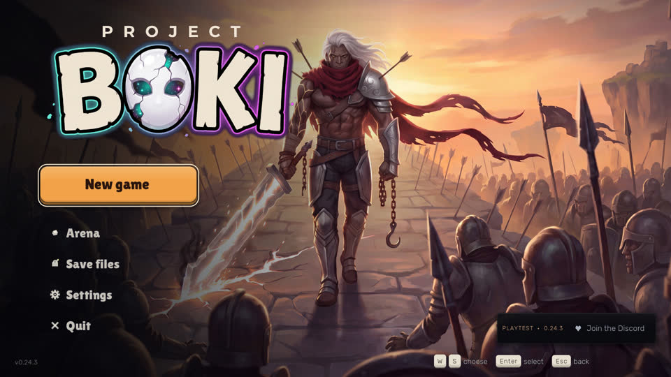

| Element | Mark |
|---|---|
| Logo/art | KEEP |
| New game / Continue | KEEP (primary) |
| Arena | LATER(first expedition finished), until then under More… |
| Demo match | MERGE into More… |
| Play with friends | KEEP (the playtest is played with friends) |
| Save files | MERGE into More… |
| Settings, Quit | KEEP |
| PLAYTEST / Discord box | KEEP (playtest only) |
| Bottom key hints | CUT (the mouse works here) |
| Version string | KEEP (small) |

```
            B O K I
        [  Continue  ]        <- primary
        [ Play with friends ]
        [  Settings  ]
        [    More…   ]  -> Arena · Demo match · Save files
        [    Quit    ]
 PLAYTEST · Discord                         v0.24.3
```

## 2. Prologue / hatch / creator — `02_prologue`, `03_hatch_first`, `04_hatch_card`, `05_creator`

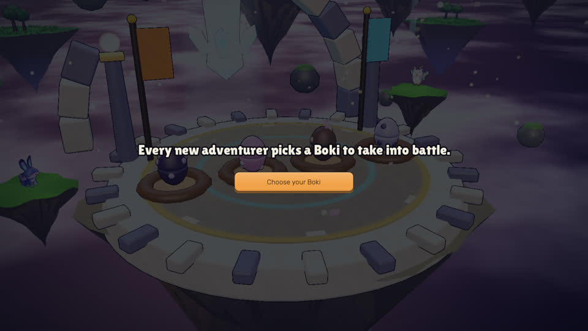 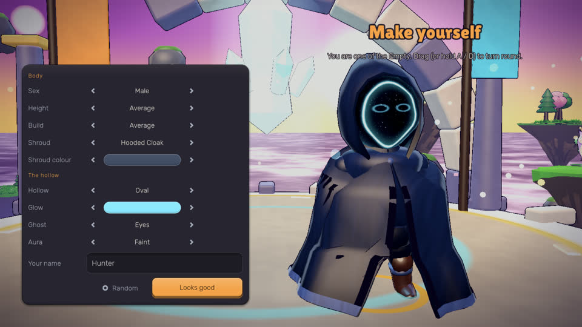

| Element | Mark |
|---|---|
| Prologue text | KEEP (shorten, tutorials-cut owns this) |
| Hatch card "Every new adventurer picks a Boki…" | KEEP, one sentence |
| Subtitle jargon ("the Empty") | CUT, in plain English: "Pick the egg you like" |
| Creator: name field, Random, Looks good | KEEP |
| Creator rows Sex, Shroud colour, Glow | KEEP |
| Creator rows Height, Build, Shroud, Hollow, Ghost, Aura | MERGE into "More looks…" (the same rows also live in pause "Change your look") |
| Egg row, naming | KEEP |
| MaskMoment relic beat | KEEP (story), no extra panel |

```
 Make yourself                      [ preview ]
 Name  [ ________ ]   (Random)
 Body       < A  B >
 Colour     ● ● ● ● ●
 Glow       ● ● ● ● ●
 (More looks…)
                         [ Looks good → ]
```

## 3. Tutorial match HUD — `tut_move.jpg`

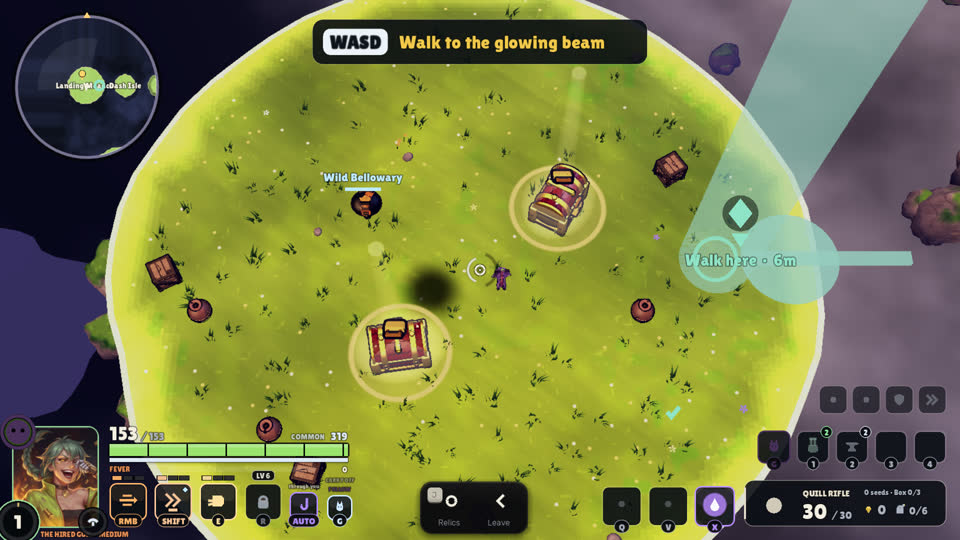

This is the place where the HUD grows. It starts with the minimal set (section 6), and each step reveals the
element it teaches through `Reveal.mark`. tutorials-cut-1108 cuts the steps from 22 to about 8. This plan only
asks that the tutorial **does not show elements it doesn't teach** (locked slots, Q/V/X, belt, counters).

## 4. Results — `06_results_tutorial`, `07_results_expedition`

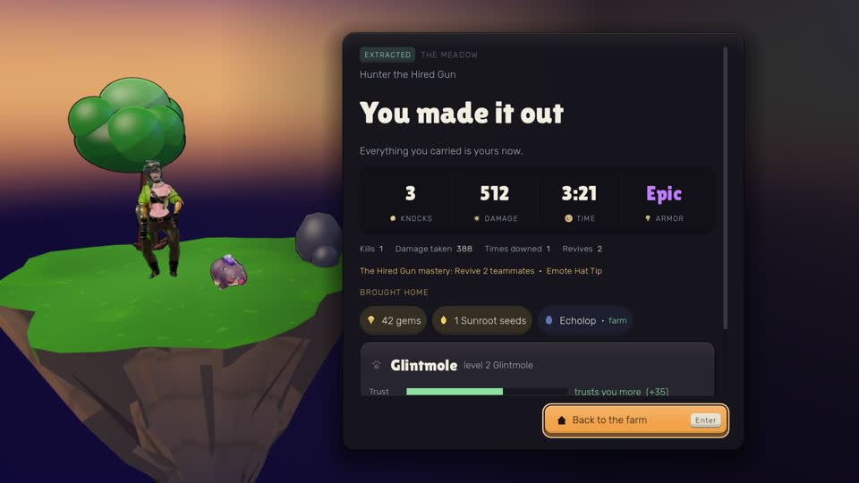

| Element | Mark |
|---|---|
| Headline + tag (EXTRACTED / FIRST EXPEDITION) | KEEP, one tag |
| "Hunter the Hired Gun" line | MERGE into the headline ("Vex extracted!") |
| Big stats KNOCKS, DAMAGE, TIME | KEEP, 3 |
| Big stat ARMOR "Common/Epic" | CUT here (it's gear, shown in Inventory) |
| Second stat line (kills, damage taken, downed, revives) | MERGE into a "Details ▾" toggle |
| Mastery / emote unlock lines | MERGE into one "New: …" line |
| BROUGHT HOME chips | KEEP (it's the point of the run) |
| Boki trust card | LATER(a Boki came along), compact, no scroll |
| Evolution modal on top of results | CUT here, queued to the farm (one modal at a time) |
| Back to the farm | KEEP (primary, always visible without scrolling) |

```
            EXTRACTED — Vex made it home
     KNOCKS 3        DAMAGE 1 240       TIME 9:12
     Brought home:  [gem x40] [seed x2] [Glintmole]
     New: Quill Rifle mastery 1           (Details ▾)
                  [ Back to the farm ]
```

## 5. Farm on arrival — `08_farm_first`, `09_farm_closed`

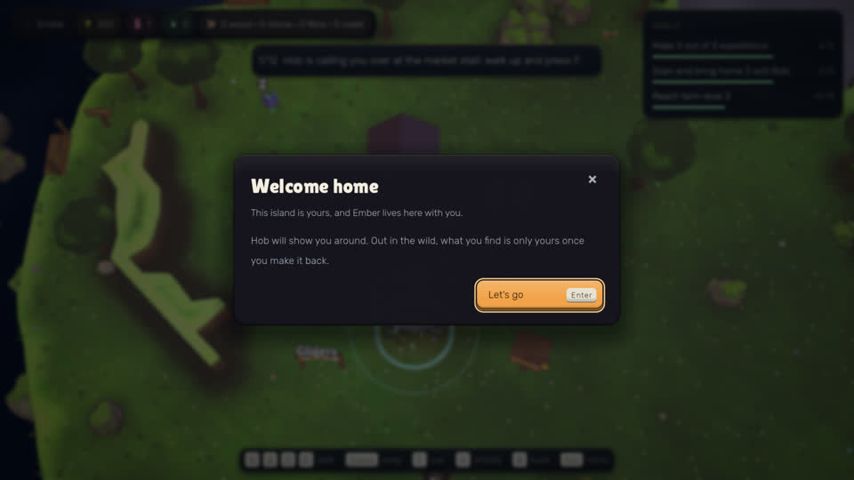 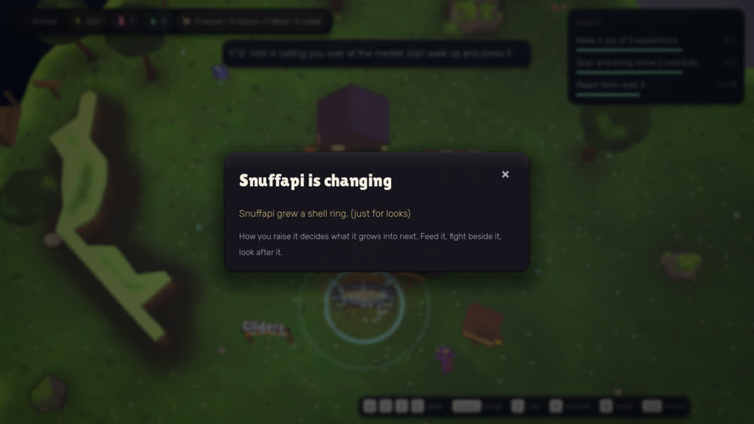

On arrival, a new player gets **two modals back to back** (Welcome home, then "Snuffapi is changing" — the
evolution of the Boki that came home). Both sit on top of the hub bar, the tutorial banner, GOALS and the key bar.

| Element | Mark |
|---|---|
| Hub bar: name, gems | KEEP |
| Hub bar: two counters + "0 wood · 0 stone · 0 fibre · 0 coals" | LATER(first pickup of that resource), each counter shows separately |
| Farm tutorial banner "1/12 Hob is calling you over at the market stall: walk up and press F" | KEEP; it **is** the what-to-do-next slot |
| GOALS card (3 goals with bars) | LATER(farm tutorial done), then one line "Next: …", full list on G/Tab |
| Key hints WASD, Space, F, Esc | KEEP until each one is used 3 times, then fade |
| Key hints whistle, build | LATER(first Boki on the farm / build unlocked) |
| "Welcome home" modal | KEEP, the only arrival modal |
| Evolution modal ("Snuffapi is changing … (just for looks)") | LATER: queued, shown after Welcome home is closed, never stacked |

```
 Ember · 200 gems                     
            ┌───────────────────────────────┐
            │  Hob is calling you — walk to him  (1/5) │
            └───────────────────────────────┘

                       (farm)

 WASD walk · F use · Esc menu
```

## 6. Expedition panel — `10_expedition_panel`

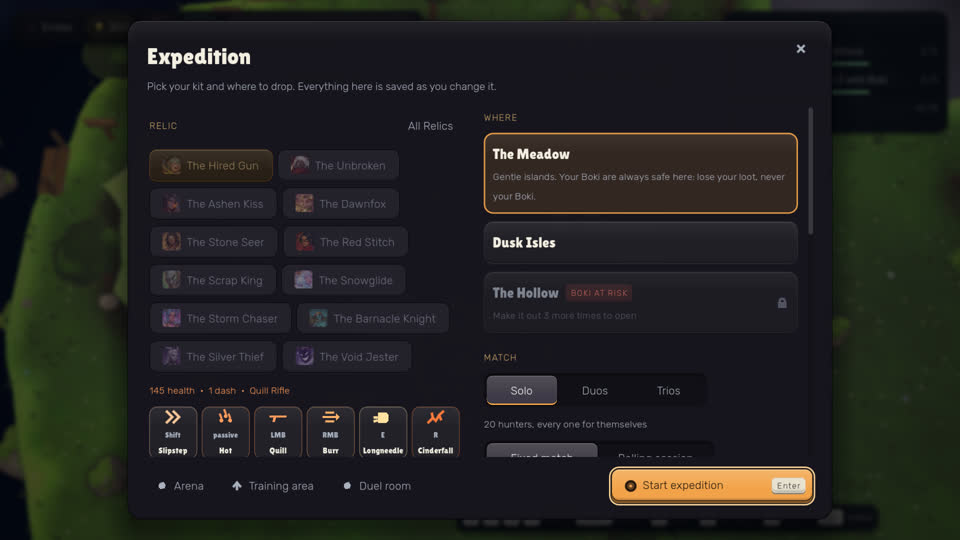

This is the busiest menu: about 30 clickable things before you can press Start.

| Element | Mark |
|---|---|
| Title + "Pick your kit and where to drop. Everything here is saved…" | KEEP the title; CUT the second sentence |
| RELIC grid: 12 hunter chips (11 locked) + "All Relics" | MERGE: the hunter is chosen in prematch (§7). Here, show one "Hunter: Vex (change)" line. "Relic" is jargon for a new player |
| Stat line "145 health • 1 dash • Quill Rifle" | CUT here (hover in §7) |
| 6-ability strip (Shift, passive, LMB, RMB, E, R) | LATER(first expedition finished), behind "Kit ▾" |
| WHERE: The Meadow / Dusk Isles / The Hollow (locked) | KEEP Meadow only until Dusk Isles unlocks; locked Hollow → LATER(1 run before it opens) |
| MATCH: Solo / Duos / Trios + "20 hunters, every one for themselves" | KEEP |
| Fixed match / Rolling session tabs (cut off at the bottom; needs scrolling) | LATER(3 expeditions finished) |
| Conditions chip + blurb (below the fold) | LATER(with Rolling) |
| Footer: Arena, Training area, Duel room (+ Play online) | MERGE into one "More ▾" |
| Start expedition (Enter) | KEEP (primary) |

```
 Expedition                                        ×
 Hunter: Vex the Hired Gun   (change)
 Where:  [ The Meadow — your Boki are always safe ]
 Squad:  ( Solo | Duos | Trios )
 More ▾                          [ START EXPEDITION  Enter ]
```

## 7. Hunter pick (prematch) — `12_prematch`

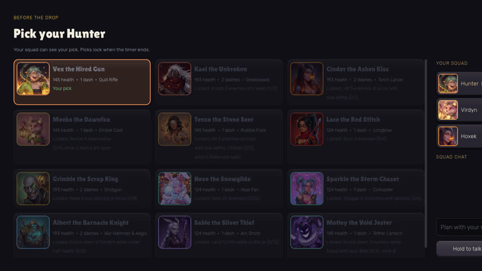

| Element | Mark |
|---|---|
| "Before the drop" + "Pick your Hunter" + subtitle | MERGE into one title line + the countdown |
| **Countdown** | KEEP, and **add it**: none is visible now (pick-countdown-30-1108) |
| 12 cards with "145 health • 1 dash • Quill Rifle" | KEEP card = portrait + name + role word; stats go to hover |
| Locked-quest text on 11 cards | CUT from the card; locked = dim + lock icon, quest on hover |
| YOUR SQUAD column | KEEP; **it is clipped off the right edge at 1920** → becomes a top strip |
| SQUAD CHAT + input | MERGE: one "Enter to chat" line, the log opens on the first message |
| Hold to talk | LATER(a human squadmate with voice is present) |

```
 Pick your Hunter                                   0:24
 Squad:  [Hunter ✓] [Sickax …] [Julkyn …]
 ┌─────┐ ┌─────┐ ┌─────┐ ┌─────┐
 │ Vex │ │ 🔒  │ │ 🔒  │ │ 🔒  │   (hover: stats / unlock quest)
 │Rifle│ │     │ │     │ │     │
 └─────┘ └─────┘ └─────┘ └─────┘ …
 Enter to chat
```

## 8. Expedition HUD — start / fight / extract

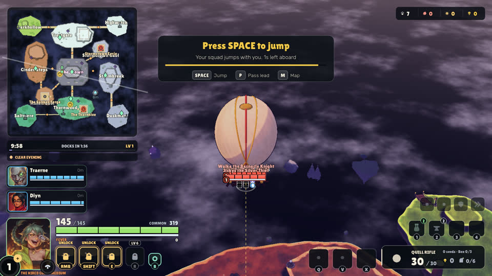 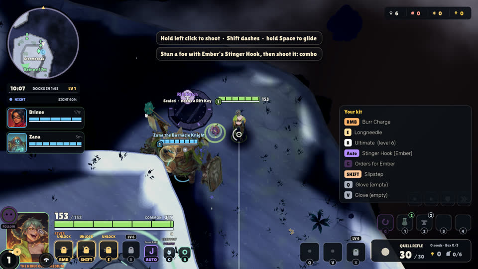
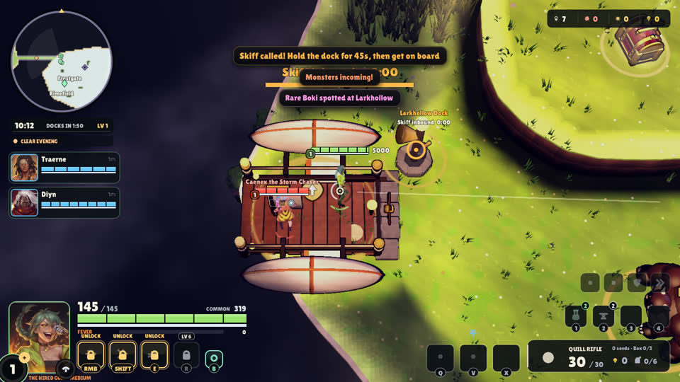 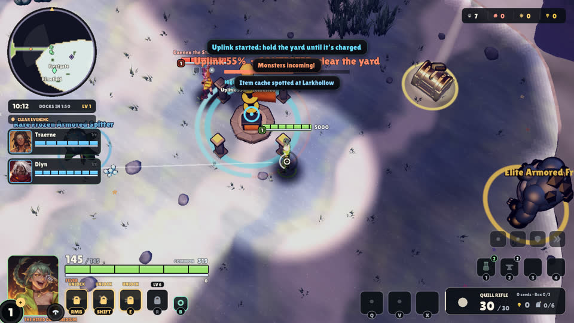

Now: about **13 groups** on screen at the drop. Target: **5 groups**.

| Element (hud.gd section) | Mark |
|---|---|
| Minimap: huge at the drop, full region names | KEEP **small circle**, nearby only; full map on M |
| Clock bar: time, DOCKS IN, LV, progress | MERGE into one line under the map: "9:58 · ship in 1:36" |
| LV in clock bar + LV badge "+" on portrait | LATER(first level-up), one place only (the portrait) |
| Weather chip "CLEAR EVENING" | LATER(first weather that changes play) |
| Squad cards (left, large) | KEEP slim: name + HP, no portrait at 1080 |
| Top-right counters (kin, knocks, dmg, gems) | TAB |
| Kill feed | LATER(first knock within 30 m) |
| Top-centre banners (ally alerts, messages, objective) | MERGE into the **one objective slot** + toast queue |
| "Rare Boki spotted…", "Item cache spotted…" | CUT the text after the first time; it becomes a minimap ping |
| Portrait | KEEP |
| "THE HIRED GU… MEDIUM" under the level circle (clipped) | CUT |
| HP 145/145 | KEEP |
| "COMMON 319" armour | TAB (armour bar stays inside the HP bar) |
| FEVER resource bar | LATER(first time it fills) |
| Ability slots RMB / SHIFT / E with "UNLOCK" | **LATER(unlock)**: a slot appears when it unlocks; no locked placeholders |
| R "LV 6" | LATER(LV 6) |
| B Boki button | LATER(first Boki with you) |
| Perk badges | LATER(first perk) |
| Boki slots Q / V / X (empty) | LATER(first Boki caught); show only filled slots |
| Utility icon row (4 icons) | CUT (TAB) |
| Belt 1–4 with counts | LATER(first consumable); show only filled slots |
| Weapon card: name, ammo 30/30 | KEEP |
| Weapon card: seeds, Box 0/3, gems, bag 0/6 | LATER(first pickup of each); bag also LATER(bag ≥ half full) |
| Drop prompt "Press SPACE to jump" | KEEP (it is the objective slot); "P Pass lead" LATER(squad of humans), "M Map" LATER(10 s after landing) |
| World labels "Rare Frozen Armored Spitter" | MERGE to "Rare Spitter", shown only when near or aimed at; never over the squad cards |
| Nameplates, reticle | KEEP (reticle restyle in hud-reticle-sv) |
| "Your kit" panel at match start (8 lines: RMB Burr Charge, E Longneedle, R Ultimate, Auto Stinger Hook, G Orders, SHIFT Slipstep, Q/V Glove (empty)) | CUT. It is a second, bigger copy of the ability row, and **it contradicts it**: the kit lists RMB/E/Shift moves while the slots show UNLOCK. Each slot gets its Reveal line instead |
| Two top-centre tip lines ("Hold left click to shoot · Shift dashes · hold Space to glide", "Stun a foe with Ember's Stinger Hook…: combo") | MERGE into the objective slot, one tip at a time; the combo tip is LATER(first stun) |
| "SIGHT 60%" (night) in the clock bar | LATER(first night) as a one-time toast, then CUT |
| Boki "FOLLOW" button on portrait, Auto (Stinger Hook) slot, G orders slot | LATER(first Boki in the match): G only once orders matter |
| World label "Rift Hatch · Sealed · needs a Rift Key" | LATER(player holds a Rift Key or is within 5 m) |
| First-seconds button guide (hud.gd:1786) | MERGE with Reveal hints (one system) |

Target layout (5 groups: ① map + time, ② objective, ③ squad, ④ me, ⑤ weapon):

```
 ┌──────┐            ┌──────────────────────────────┐
 │ map  │            │ ② Hold the uplink — 55%       │
 │  ①   │            └──────────────────────────────┘
 └──────┘                 (toast: Monsters incoming!)
 9:58 · ship 1:36
 ③ Traerne ▮▮▮▮▮
   Diyn    ▮▮▮▮▮

                         (world)

 ┌────┐ 145 ▮▮▮▮▮▮▮▮▮▮▮                 ┌──────────────┐
 │face│ [RMB][Shift]   ← only unlocked   │ ⑤ Quill Rifle │
 └────┘  ④                               │    30 / 30    │
                                         └──────────────┘
```

Fight/extract specifics (m_board, m_uplink): 3–4 banners overlap each other and the uplink bar. Use the
objective slot for "Uplink 55% — clear the yard" and the toast queue for "Monsters incoming!" (one at a time).
Cache/Rare-Boki text becomes a ping.

## 9. Pause — `11_pause_farm`, `14_pause_match`

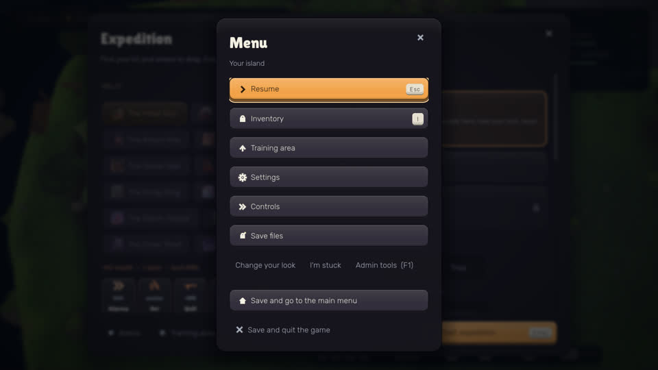 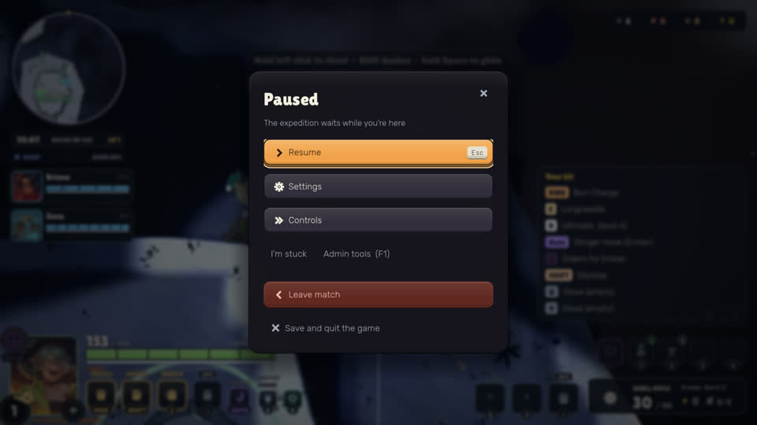

Farm: 6 big buttons + a minor row of 3 + 2 exits = 11 items. Match: already lean (Resume, Settings, Controls,
I'm stuck, Admin tools, Leave match, Save and quit the game). Admin tools (F1) is shown to players in both.

Now (overlay.gd:206): Resume, (Change Hunter), Inventory, Training area, Settings, Controls, Save files;
a minor row of Change your look, I'm stuck, Admin tools (F1); in a match, Skip tutorial / Leave match;
then Save and go to main menu, Save and quit.

| Element | Mark |
|---|---|
| Resume | KEEP |
| Settings | KEEP (Controls becomes a tab inside Settings: MERGE) |
| Leave match / Skip the tutorial (match only) | KEEP |
| Save and quit to menu, Quit game | KEEP |
| Inventory, Training area, Save files, Change your look | MERGE into More… |
| I'm stuck | MERGE into More… (and LATER: shown on the main list only if the player hasn't moved for 20 s) |
| Admin tools (F1) | CUT from player builds (dev/admin only) |
| Title "Menu / Your island" | MERGE: "Paused" on both (the match one already says it) |

```
      Paused
  1 Resume
  2 Settings
  3 More…
  4 Save and quit to menu
  5 Quit game
```

---

## Overlaps with running / queued UI jobs

| Job / branch | Overlap | Note |
|---|---|---|
| **ui-void-masks** (PR #15 cba1da1f5, -2 153acf74e, READY; follow-up escalated) | Restyles every menu | Style only. This plan changes *what* is shown, not the look. Build on top of it. |
| **expedition-screen-simplify-1108** (ext/expedition-pick-simplify-1108 e5c190716, on void-masks-2) | §6 RELIC grid, §7 cards | It turns the Expedition panel's hunter grid into big portrait + name + role cards with locked hover. That's the right card, but this plan wants it in **one** picker (TASTE 5). Its right column (Where/Match/Conditions) was left as is; §6 asks for Rolling + Conditions to be LATER. Hand it to that job. |
| **pick-countdown-30-1108** (queued) | §7 countdown | It adds the missing countdown. Keep it. |
| **pause-menu-1108** (ext/pause-menu-1108 191f60db2, partial) | §9 | Numbered 1–5 column; Inventory/Save files/Training moved to the minor row. Compatible. Add: Admin cut, "I'm stuck" + "Change your look" into More…, Controls into Settings. |
| **hud-reticle-sv-1108** (ext/reticle-style-1108 586771d55, PR #25) | §8 reticle | No conflict; the reticle stays KEEP. |
| **tutorials-cut-1108** (CLAIMed, job 220037-a4) | §3, §5 banner | Its FirstTimeHint should **be** the Reveal helper (one helper, one save key set). Farm 12→5 matches §5. |
| **farm-optional-1108** (CLAIMed, job 220048-a4) | §5 arrival | Its "while you were away" summary is one more arrival modal. It must join the §5 modal queue (Welcome home → away summary → evolution), one at a time, or MERGE into Welcome home. |
| ext/tutorial-declutter c613689f1, ext/tutorial-low-cds b5880e1c7 (READY) | §3 | Tutorial-world only, no conflict. |
| **recast-clarity-1108** (CLAIMed) | §8 adds a HUD cue | Must live inside group ④ (on the ability slot), not as a new group. |
| **keybinds-1108** (CLAIMed) | §8 key labels | Labels only on revealed slots. |

## Suggested build jobs (in order)

1. **reveal-helper**: the `Reveal` module + save keys + old-save migration (all seen). It is shared with tutorials-cut.
2. **hud-declutter**: §8. Gating, objective slot + toast queue, small minimap, clock merge. hud.gd is frozen,
   so the gating goes in a new `hud_reveal.gd`, which hud.gd calls (net-zero lines in hud.gd).
3. **arrival-declutter**: §4 + §5 (modal queue, results trim, hub bar, goals line).
4. **menus-more**: §1, §6 footer, §9 (coordinate with pause-menu-1108 and expedition-pick-simplify).
5. **creator-trim**: §2.

Check for each: the screenshot of the same screen before and after at 1920x1080 and 1280x720, and every HUD group
inside the safe area.

## TASTE questions for the owner (each has a default; work proceeds on the default)

1. **Minimap at the drop**: a small circle, nearby only, full map on M? *Default: yes, small circle.*
   Alternative: keep the big map during the drop only, then shrink it on landing.
2. **Locked ability slots**: hide them until they unlock? *Default: hide, with a flash + "New: Shift — dash" on
   unlock.* Alternative: show greyed outlines with no "UNLOCK" text.
3. **Title menu**: Continue, Play with friends, Settings, More…, Quit? *Default: yes, with Arena / Demo / Save
   files under More….* Alternative: Arena stays on the main list.
4. **Creator**: only 3 rows (body, colour, glow) + "More looks…"? *Default: yes.* Alternative: all 9 rows, but
   in two columns.
5. **Two hunter pickers** (the Expedition panel RELIC grid and prematch "Pick your Hunter"): keep one? *Default:
   the Expedition panel shows one "Hunter: Vex (change)" line. "change" opens the expedition-pick-simplify card
   grid, and prematch reuses that same grid with the countdown.* Alternative: pick only in the Expedition
   panel; prematch only shows the squad and the countdown.

Decided without a question (alternative noted): top-right counters go to Tab, and gems flash for 2 s on pickup
(alternative: gems always visible).
