# Void & Masks UI pass: before / after (ext/ui-void-masks 6afeee56e, PR #15)

Refs: ../../art-refs/ui/ui_style_void_A2_base.png (base), ui_style_void_A1_alt.png. 1920x1080, software GL (xvfb) via `--void-ui-shots=<dir>`; before = origin/main d255acbee with the same tool. HUD pairs: `--tutorial-hud-shots` on GPU workers, 1280x720. `after_720p_all.jpg`: every screen at 1280x720.

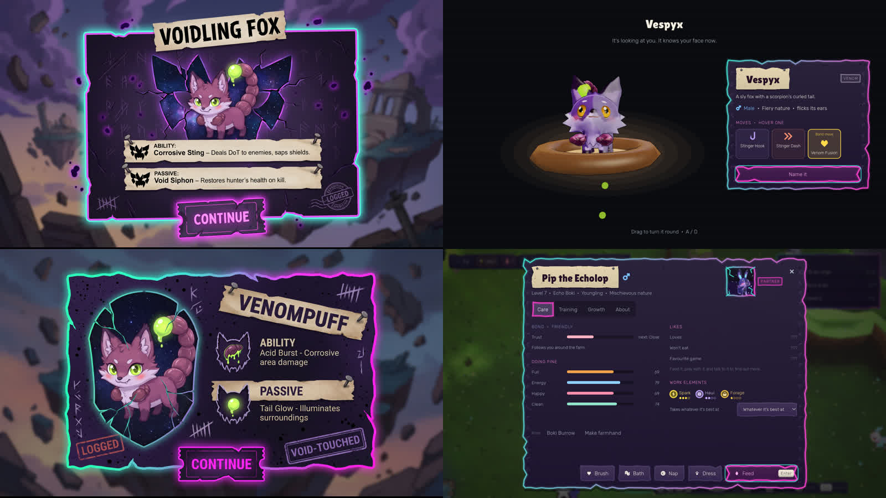

**01_title**

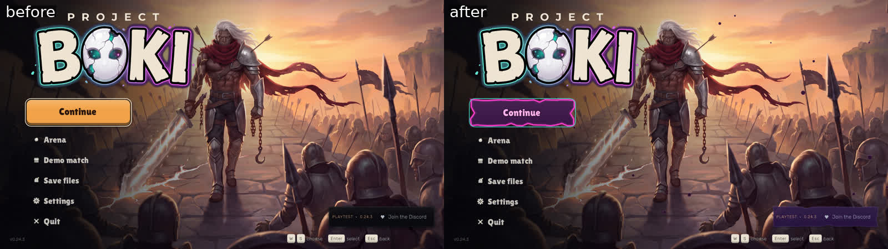

**02_save_slots**

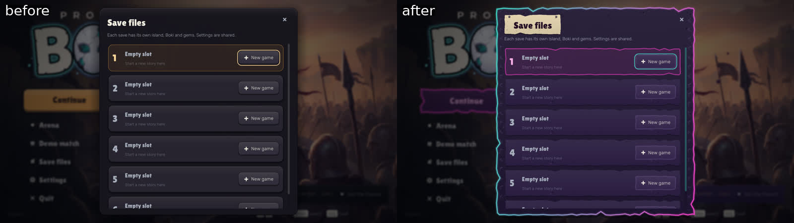

**03_settings**

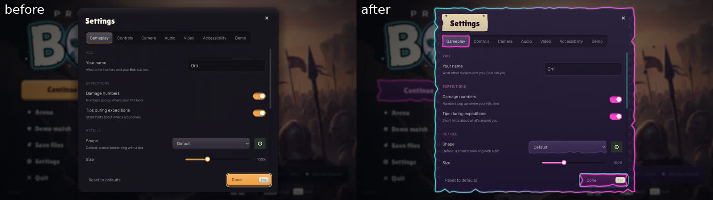

**04b_egg_pick**

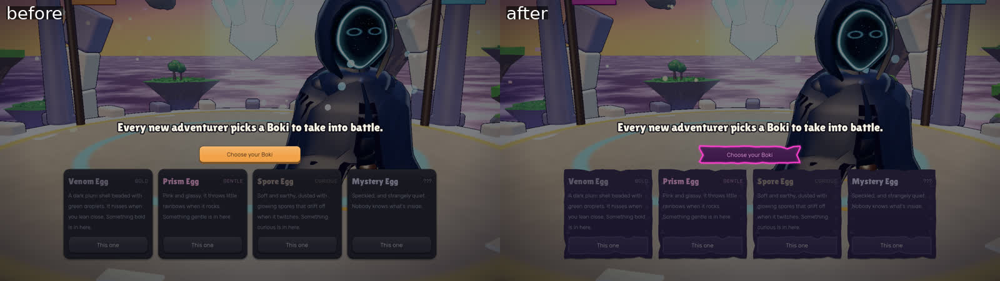

**04c_boki_reveal**

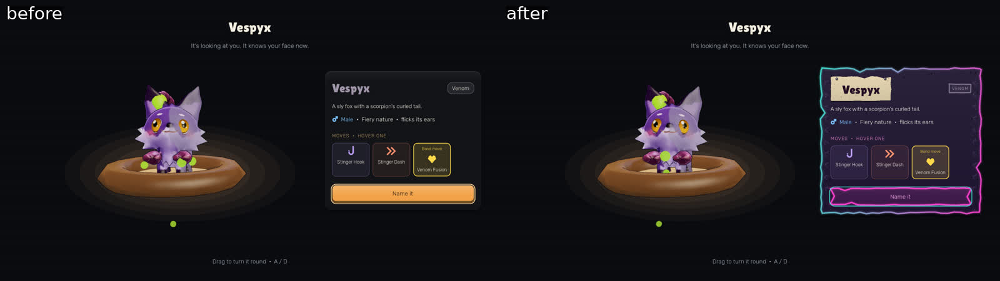

**04_hatch_card**

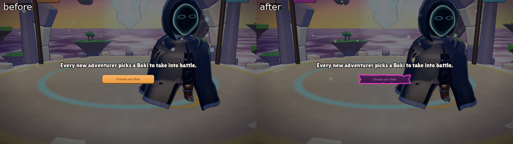

**05_creator**

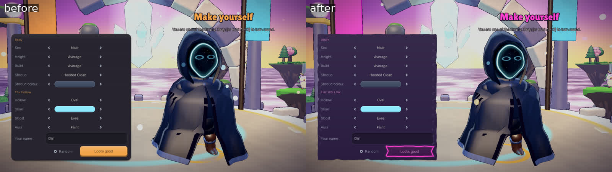

**06_welcome_modal**

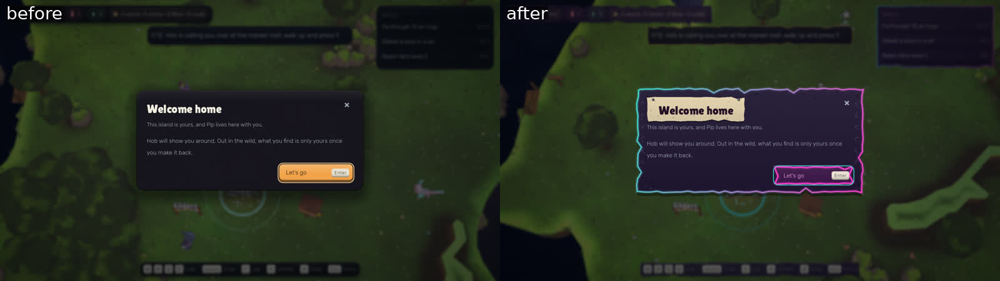

**07_farm_goals**

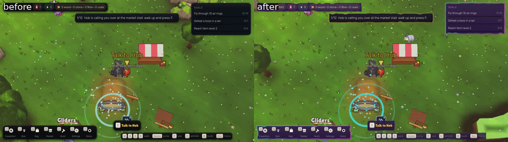

**08_job_board**

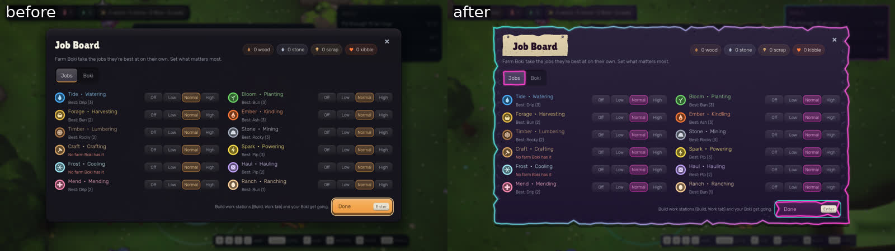

**09_kin_burrow**

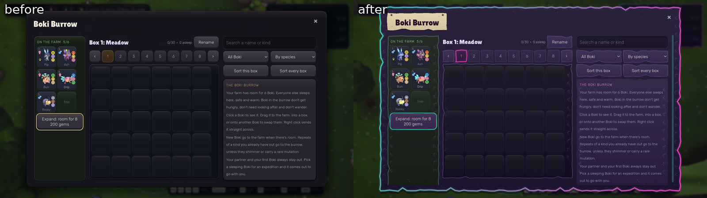

**10_boki_page**

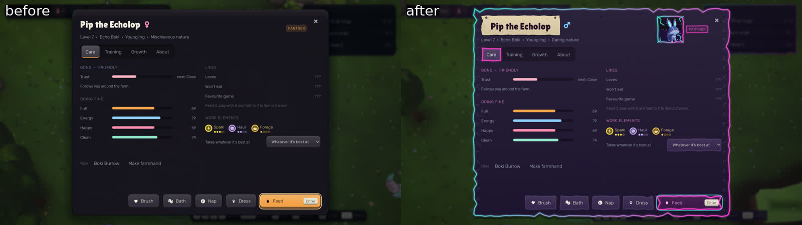

**11_market**

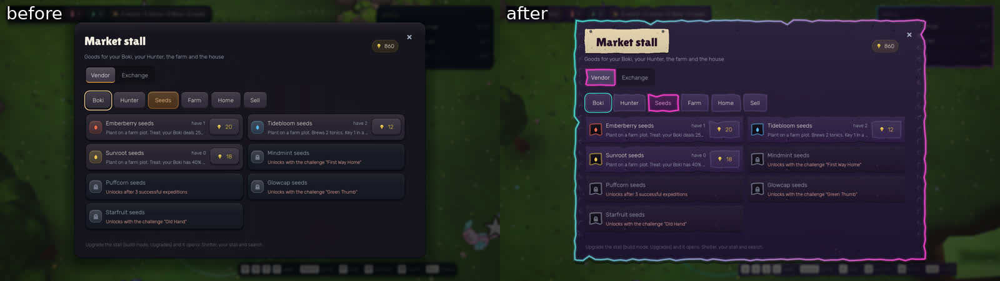

**12_black_market**

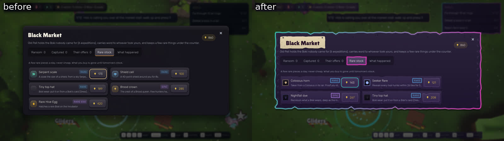

**13_build_menu**

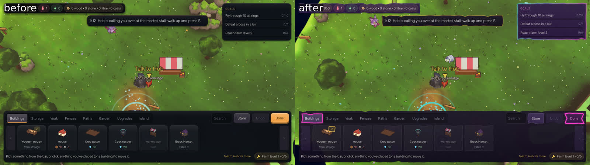

**14_pause**

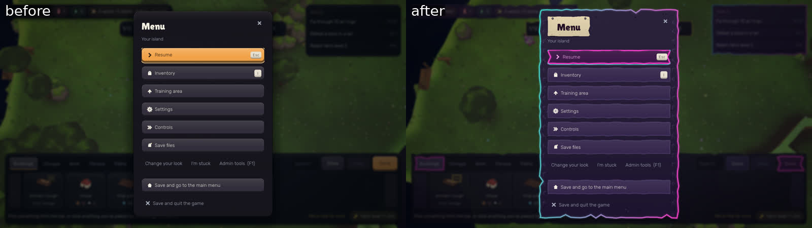

**hud_01**

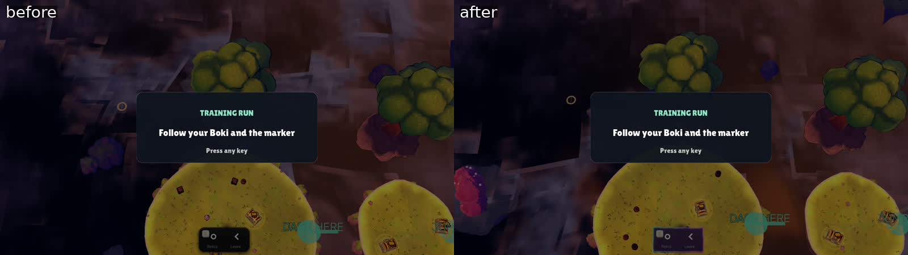

**hud_06**

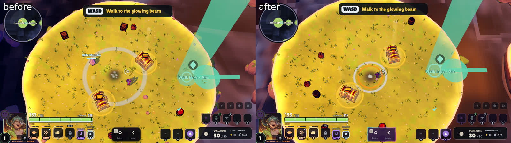

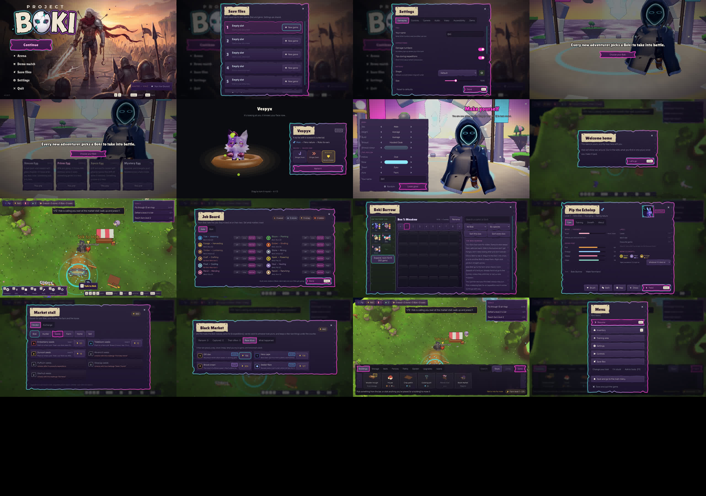
