# Animation quality audit: every Hunter walking, running and using the arms (Nov 8)

The owner (Nov 8): all Hunter animations look janky, in walking and in arm use. The `anim-time-*` jobs fixed timing
only. This page measures what each Hunter does today at the speed he really moves (4.55 to 4.85 m/s, so effectively always
at the run ring), fixes the cause they share, and lists what is left per Hunter.

## How this was measured

- **`godot -- --anim-audit [--wardens=a,b] [--json=file]`** (tools/anim_audit.gd, headless, 19 s for all 12). It drives the
  game's own locomotion hand-off (the state carries the speed; WardenClips blends and scales) at 2.2 and 4.65 m/s and
  reads the bones.
  - **slide**: how far a foot in the lowest 30 % of its height range moves against the floor, |move speed - foot
    backward speed|, as a share of the move speed. 0 is a planted foot; 100 % is a foot that skates.
  - **counter**: the reach-weighted negative correlation of each hand and the same side's foot (forward position).
    +1 is a natural counter-swing, -1 is pacing (arm and leg of one side go forward together).
  - **clip speed**: the feet's backward speed at rate 1 (`foot_mps`), against the move speed.
  - **bob**, **steps/s** (cadence), loop seams and first-pose gaps (`pop`, in body heights) of idle to walk, walk to run.
  - Attack rows (two per Hunter): the largest one-frame hand jump and the free arm's travel (body heights), and the
    share of frames with an arm raised 60 degrees or more and sideways (T-pose), all read from the hips.
- **`godot -- --anim-shots --shots-dir=<dir>`** (tools/anim_shots.gd, GPU): walk, run, idle and two attacks at the match
  camera, 8 frames each. The walk and run use the live hand-off seen from the side with floor posts that scroll at the
  move speed, so a sliding foot slides against them. The "before" is a frozen copy of this branch's parent.
- The gate is `--anim-audit` itself (registered in tools/check_registry.gd): slide over 25 % of the run speed, or a
  counter under 0.3 on a Hunter with legs, fails. `ostra` and `rimewright` have no stepping legs and are exempt, and
  are listed below as open.

## What is wrong with all of them

1. **The stride is short for the speed.** On 10 of 12 Hunters the clips' feet move at 1.8 to 4.0 m/s while the body
   moves at 4.65, so the planted foot slides 25 to 76 % of the speed. The clip rate could not be raised enough alone:
   it is held to a plausible cadence by the walk/run keys.
2. **Arms pace.** On 6 Hunters an arm swings with its own side's leg (counter -0.65 to -0.96). The clips are authored
   in Blender with a hand-keyed IK swing and the sign differs per Hunter, so no single sign fixes all.
3. **Held-weapon arms are static in a gait** (Lace's bow arm, Vex's pistol arm). That is deliberate and kept.
4. **No loop or blend pops.** Loop seams are under 0.005 body heights, contact walk to run is 0 and walk to run 0.14 at
   most. Nothing to fix there. Idle to walk first-pose gaps are 0.06 to 0.45 body heights, covered by the blend.
5. **Attacks leave an arm out.** Six Hunters hold an arm sideways (T-pose) for over half an attack clip.

## The fix, once for everybody

`WardenGait` (scripts/heroes/warden_gait.gd) runs after the tree has advanced and fades with how much the legs run the
body (not in the air, a crouch, or a move that owns the body):

- **Stride and rate.** `loco.foot_mps` is the clips' measured foot speed, `loco.stride` the thigh stretch about its running
  mean. The move speed over the foot speed sets the loco rate (0.6 to 1.4); the stretch carries the rest.
- **Arm counter-swing.** `loco.arm_swing` {"L"|"R": gain} turns that upper arm about the side axis so the
  shoulder-to-hand pitch follows minus the same side's thigh, around the arm's running mean. A static arm gets a swing
  too. It is off while an upper-body move owns the arm.
- The numbers are per Hunter in content/rules/warden_anim/*.json, measured by `--anim-audit`, with the sweep that chose
  the `stride` gains. `ostra` and `rimewright` keep their clips (no leg motion to stretch).
- The glbs are not re-baked (other art jobs are in flight on them), so this is a runtime layer. When an art job re-keys
  a gait, re-run `--anim-audit` and re-tune that Hunter's three keys.

## Free arm in attacks (`WardenFreeArm`)

Data `"free_arm": {clip: "L"|"R"}` (content/rules/warden_anim/<art>.json) names the arm a move leaves unused. While that
clip plays, its upper arm, forearm and hand ease (10/s) to their idle rotation over whatever the clip keys, so the free arm
hangs relaxed instead of standing out. A runtime layer, like the gait: the glbs are not re-baked (no Blender on this worker; the
clip sources in tools/art1 are unchanged). Done for `ashwick` (lance, shot), `dredge` (throw, shot) and `tender` (seed, shot_r).
`--anim-audit` reports `t_free` (share of frames the free arm is raised 60 degrees or more and sideways) next to `t_pose`
(either arm); `t_pose` stays up where the weapon arm itself reaches out.

## Per Hunter, before to after

Slide is the share of the move speed (lower is better). Counter is +1 natural, -1 pacing. Clip speed is the feet's
speed in m/s against 4.65. Bob (cm of hip) and cadence are as after.

| Hunter | Slide walk % | Slide run % | Clip speed m/s | Counter | Bob cm | Steps/s |
|---|---|---|---|---|---|---|
| `archer` | 65 → 29 | 46 → 13 | 2.5 → 4.7 | -0.95 → +0.61 | 5 | 3.3 |
| `ashwick` | 6 → 5 | 18 → 12 | 5.1 → 4.6 | -0.93 → +0.80 | 9 | 2.5 |
| `bulwark` | 22 → 18 | 25 → 19 | 4.0 → 4.6 | +0.17 → +0.64 | 4 | 5.0 |
| `dolm` | 54 → 25 | 38 → 18 | 3.1 → 5.5 | -0.86 → +0.72 | 4 | 3.3 |
| `dredge` | 42 → 30 | 28 → 12 | 3.9 → 4.5 | +0.92 → +0.91 | 17 | 2.5 |
| `gunslinger` | 50 → 21 | 25 → 23 | 3.6 → 4.5 | +0.90 → +0.89 | 7 | 4.2 |
| `juggernaut` | 53 → 25 | 27 → 12 | 3.4 → 4.5 | -0.65 → +0.84 | 16 | 3.3 |
| `mage` | 59 → 19 | 42 → 9 | 2.7 → 4.8 | +0.95 → +0.89 | 7 | 4.2 |
| `ostra` | 100 → 100 | 100 → 100 | 0.0 → 0.0 | +0.00 → -0.00 | 4 | 0.0 |
| `rimewright` | 93 → 93 | 90 → 90 | 0.4 → 0.4 | -0.39 → -0.39 | 1 | 1.7 |
| `tender` | 76 → 39 | 62 → 17 | 1.8 → 3.9 | -0.82 → +0.39 | 5 | 6.7 |
| `thief` | 73 → 39 | 60 → 17 | 1.8 → 4.3 | -0.96 → +0.82 | 5 | 4.2 |

Strips under each Hunter: rows are walk before, walk after, run before, run after (8 frames at 10 fps, side view, floor
posts scroll at the move speed).

## Worst three, per Hunter

**Lace (`archer`)**
1. Feet slid 46 % of the run speed (fixed: 13 %); the right arm pumped with its own side's leg (fixed, counter +0.61).
2. The bow arm hangs static in a gait (reach 0.05 body heights) by design; the free arm stands out sideways for 21 % of the loose clip.
3. Idle to walk first-pose gap 0.29 body heights (blend-covered).

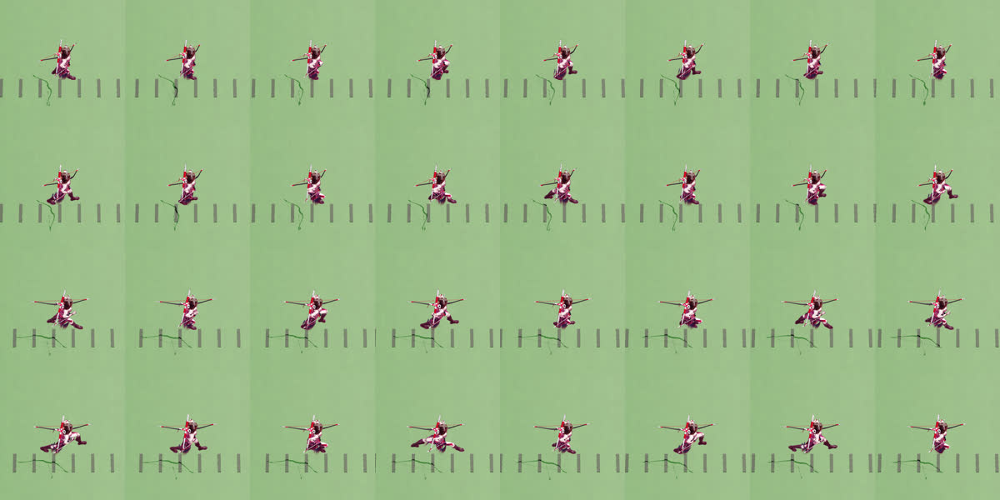

**Cinder (`ashwick`)**
1. Both arms swung with their own side's leg (counter -0.93, fixed to +0.80); the run clip ran 12 % ahead of the move (fixed).
2. Both attacks held the free (left) arm out to the side for 92 to 96 % of the clip (T-pose; fixed: 0 %, the arm hangs loose, see "Free arm" below).
3. Idle to walk first-pose gap 0.38 body heights.

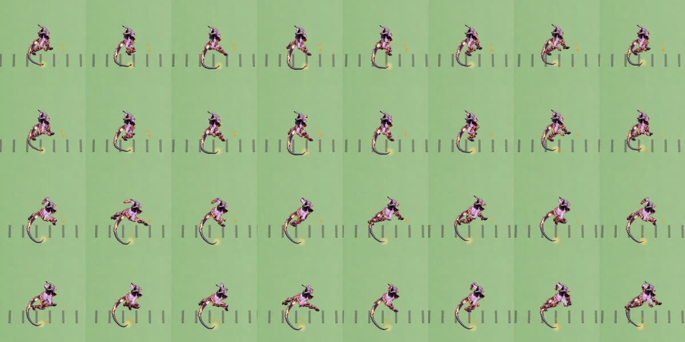

**Mossy (`bulwark`)**
1. Cadence 5 steps/s on a 2 m giant (a shuffle); not changed.
2. The left arm hung nearly still against the legs (counter +0.17, now +0.64). Slide only fell 25 % to 19 %: the nearest to the gate.
3. lmb_throw and lmb_slam jump the hand 0.5 to 0.64 body heights in one frame.

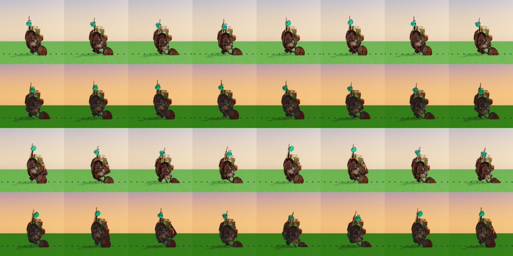

**Tenzo (`dolm`)**
1. Feet slid 38 % of the run speed and 54 % of the walk (fixed: 18 % and 25 %); the stride was half of the move.
2. Arms swung with their own side's leg (counter -0.86, fixed to +0.72).
3. lmb_punch and lmb_throw fling the free arm 1.3 to 1.5 body heights with a 0.4 to 0.67 hand jump.

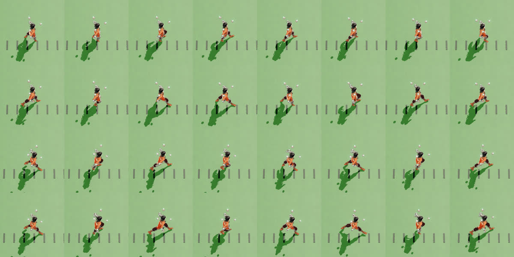

**Grimble (`dredge`)**
1. Hip bob 17 cm at a run (12 % of his height); not changed.
2. Idle to walk first-pose gap 0.45 body heights, the largest of the roster.
3. The throw held the free arm sideways for most of the clip (fixed: the free arm is loose; the thrower's own arm still reaches out, 62 %) and the free hand still travels 1.4 body heights, because the torso spins under it; slide 28 % to 12 % (fixed).

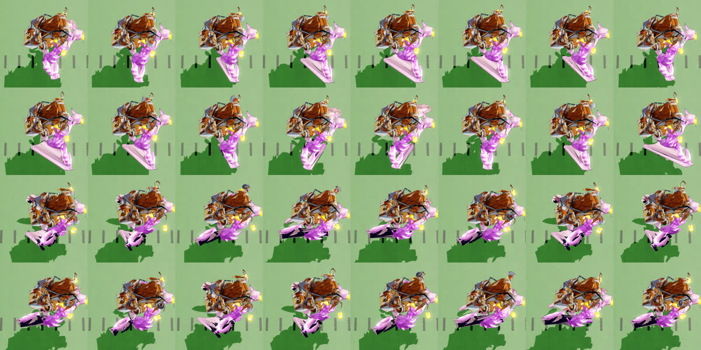

**Vex (`gunslinger`)**
1. Right (pistol) arm hardly moves in a gait (reach 0.06): held-weapon arm, kept.
2. Slide 25 % to 23 % at a run (walk 50 % to 21 %): the stride stretch is capped by the clip's own timing.
3. Idle to walk first-pose gap 0.29 body heights.

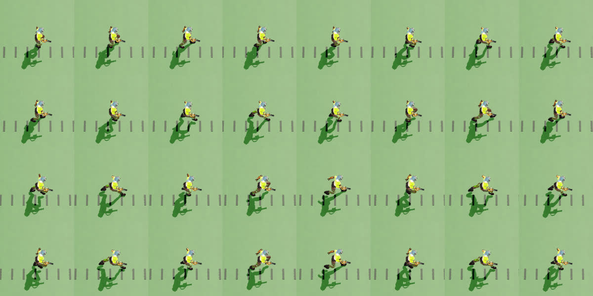

**Kael (`juggernaut`)**
1. Feet slid 27 % at a run, 53 % at a walk (fixed: 12 %, 25 %); the left arm paced with its leg (counter -0.65, fixed to +0.84).
2. Hip bob 16 cm at a run (10 % of his height); not changed.
3. The slam flings the free arm 1.7 body heights and holds an arm out for 29 to 46 %.

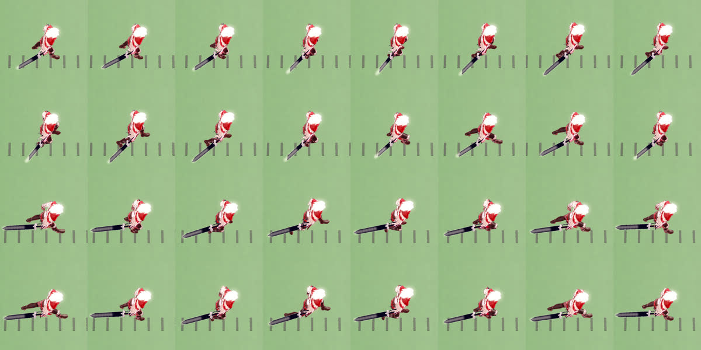

**Sparkle (`mage`)**
1. Feet slid 42 % at a run, 59 % at a walk (fixed: 9 %, 19 %).
2. rmb (cast) holds an arm sideways for 62 % of the clip.
3. Cadence 4.2 steps/s with a 0.27 first-pose gap into the walk.

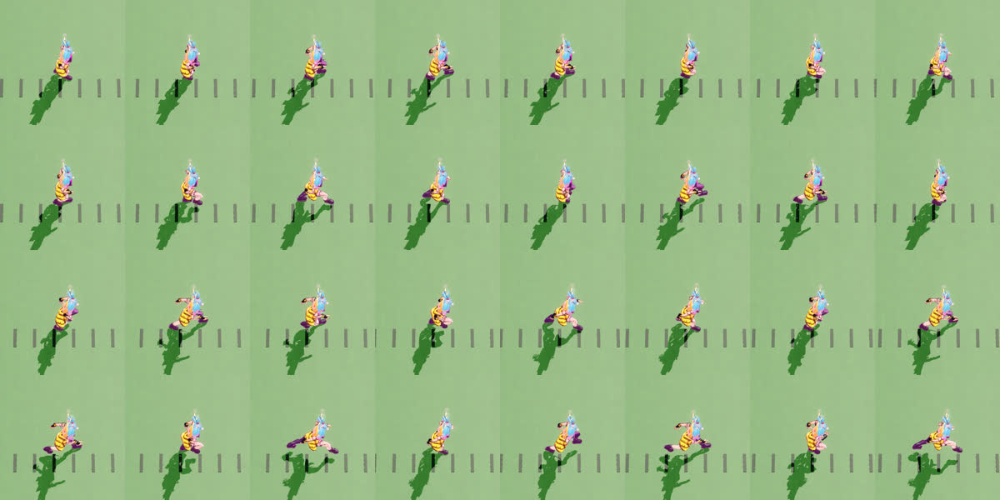

**Motley (`ostra`)**
1. Legs never step: he hovers along (foot speed 0 against 4.65 m/s, slide 100 %). Unchanged: needs new clips.
2. orb holds an arm sideways for 100 % of the clip, snap for 75 % and flings the free arm 1.64 body heights.
3. No arm swing (reach 0.03).

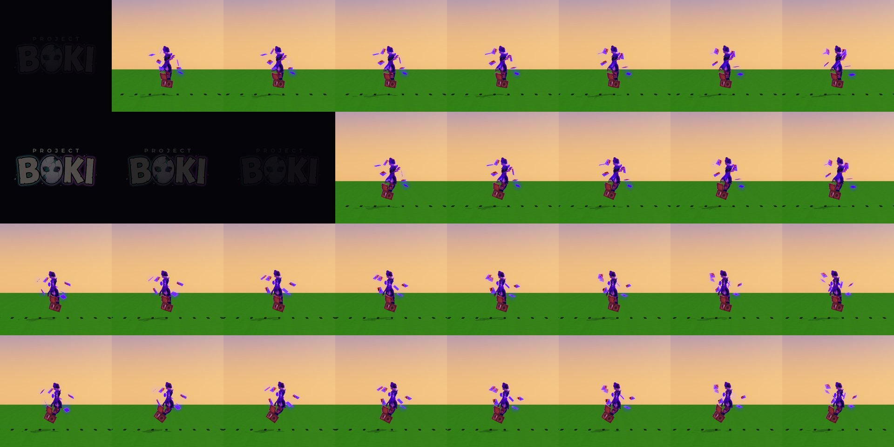

**Neve (`rimewright`)**
1. Legs do not step: she skates (clip foot speed 0.4 m/s against 4.65 m/s, slide 90 %). Unchanged: needs a new gait clip.
2. Arms barely move in a gait (reach 0.14 and 0.01).
3. Nothing else is wrong: loop seams and the idle gap (0.06) are clean.

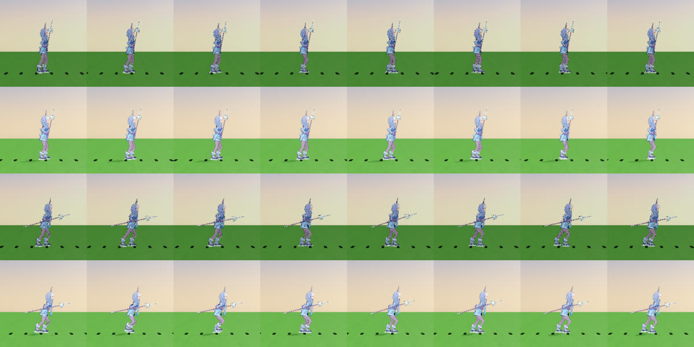

**Meeko (`tender`)**
1. Feet slid 62 % of the run speed, 76 % at a walk (now 17 %, 39 %). A 0.65 m body takes 6.7 steps/s.
2. The left arm paced its leg (counter -0.82, now +0.39, still weakest).
3. seed and shot_r held the free arm sideways for 71 to 88 % (fixed: 0 to 4 %; the free arm's travel fell 1.0-1.2 to 0.7-0.8 body heights; shot_r's remaining 71 % is the aiming arm itself). Foot speed stays at 3.9 of 4.65 m/s (gain cap 1.5, rate cap 1.4).

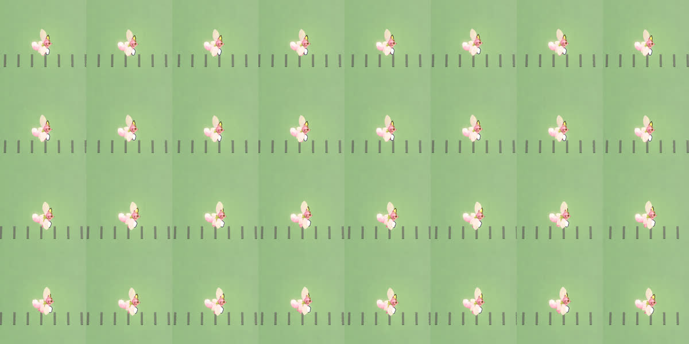

**Sable (`thief`)**
1. Feet slid 60 % of the run speed, 73 % at a walk (now 17 %, 39 %); both arms paced their legs (counter -0.96, fixed to +0.82).
2. vault_r flung the free arm 2.6 body heights and held an arm sideways for 58 % (fixed: free arm, `vault_r` left and `vault_l` right; the free arm hangs and the other pistol arm keeps the star: free arm 0.0 body heights and 0 % sideways, any arm 17 %). The attack rows now read the arms from the hips (a whole-body flip no longer counts as arm travel): from the hips the old clip's free arm moved 1.45 body heights. Before/after (top/bottom, 8 frames, `--close`): 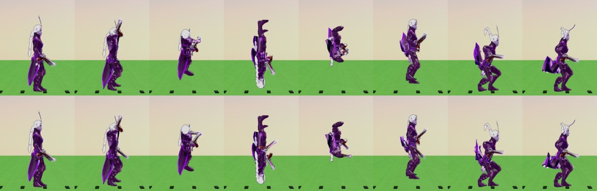
3. Idle to walk first-pose gap 0.20.

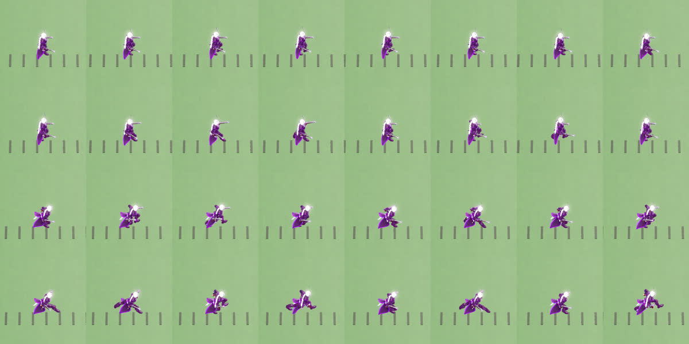

## What is left

Split into backlog items per Hunter (role build):

- `ostra`: legs that step (hover now), and an attack arm that is not a T-pose.
- `rimewright`: a gait clip with a real stride (skate now).
- `dredge` and `juggernaut`: hip bob of 15 to 17 cm at a run.
- Arm use in attacks: `ostra`, `mage` hold an arm sideways (`ashwick`, `tender`, `dredge` done: free arm); `bulwark`
  and `dolm` jump a hand 0.4 to 0.67 body heights in one frame.
- `tender`: the stride cap (foot speed 3.9 of 4.65), and a stronger counter-swing (+0.39).
- `gunslinger` and `bulwark`: slide 23 % and 19 % at a run, near the gate's 25 %.
- Idle to walk first-pose gaps over 0.25 (`dredge`, `ashwick`, `juggernaut`, `archer`, `gunslinger`, `mage`).
