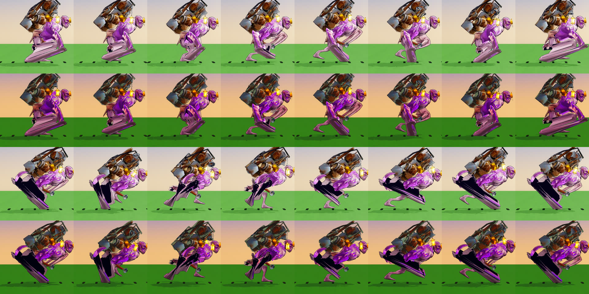
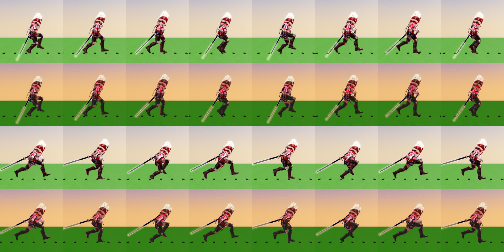
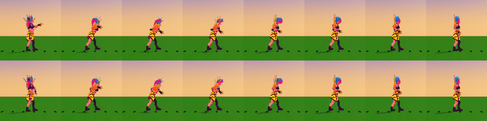

# Animation quality audit

## Monsters at match zoom: every state on the body (Nov 10)

`scripts/match/mob.gd` telegraphs every attack on the ground; `mob_models.gd` sculpts the six common monsters
(the brute family includes the Watcher). Audited by reading the pivot code `Mob.render` drove before, state by state.
`ok` = a real move; `thin` = one small tweak (a lean, a flare); `static` = nothing but the shared body lean, so the
tell or the reaction did not read on the body. `n/a` = the kind cannot enter the state (no attack, never moves).

| kind | idle | walk / run | wind-up | strike | stagger | hit flinch | death |
|---|---|---|---|---|---|---|---|
| skitter | thin (legs shiver, jaw) | ok walk, run = walk | ok (jaws, legs splay) | thin (jaws only) | static | static (lean) | static (shared pop) |
| spitter | ok (leaf sway) | thin (bulb scale 3%) | ok (bulb swells, leaves lift) | thin (one tilt) | static | thin (leaves) | static |
| brute / warden | ok (breath, head turn) | ok walk, run = walk | ok (fists overhead) | ok (arms slam) | static | static | static |
| puffbomb | thin (hops while still) | ok | ok (swell, flap) | n/a (it bursts: death) | static | static | static |
| sentinel | ok (crystal spins) | n/a (shoves only: static) | ok (spin up) | static (spin just stops) | static | static | static |
| glimmerkin | thin (hops while still) | ok | n/a | n/a | static | static | static |

Cross-cutting gaps: **stagger and hit flinch were the shared lean for every kind** (nothing on the limbs, jaws, leaves or
crystal), **death was one swell-and-flatten for every kind**, **run was the walk**, and the **strike had no follow-through
on four of five attacking kinds**.

### What changed

`scripts/match/mob_anim.gd` (`MobAnim`) holds keyed moves per kind and state (tracks of pivots, channel and keys, baked
once into 32-sample curves), and `Mob.render` calls `MobAnim.pose` instead of the per-kind `match` block it replaces.
Every kind now has the table below; `check` runs on all of it.

| state | what plays | phase |
|---|---|---|
| idle | slow breathing / sway per kind, jaw chew, ear twitch, crystal spin | loop (`IDLE_S`, offset per monster) |
| walk | skitter tripod, brute stride and arm counter-swing, spitter root hop, puffbomb and glimmer bounds | gait distance (`Mob.anim`) |
| run | the walk at 1.4x amplitude (above 3.6 m/s) | same |
| wind-up | gather, coil, raise, inflate, spin up | `MobAnim.windup_k`: **the same fraction the ground telegraph fills with** |
| strike | the blow and its follow-through (jaw snap and leap, spit recoil, slam and heave, crystal kick) | blow + recovery, `RECOVER_S` |
| stagger | slack legs / drooping leaves and ears / bowed brute / dimmed crystal | loop, 2 s |
| flinch | a 0.12 s recoil along the hit flash | `FLASH_S` |
| death | per kind: legs curl, bulb wilts, brute topples, puff bursts, crystal cracks out, ears droop | `DEATH_S` (0.32 s) |

The wind-up cannot drift from the telegraph: `Mob.sim`, the proxy path (`_net_telegraph`) and `MobAnim.phase_of` all use
`windup_k(st_t, windup)`, and `--mob-anim-check` steps the real sim and compares the two every frame.

### Proof

`godot -- --mob-anim-check` (registered in `tools/check_registry.gd`): every state a kind can enter has tracks that move
at least 0.02 and loops that close; every pivot named exists in the model; the wind-up fraction equals the telegraph's
shader progress on every frame, lasts the data's `windup` seconds to within one frame, and the first pivot sits on its
key at the end; 30 monsters pose in under 0.5 ms a frame (0.21 ms measured, 300 frames, headless).

`--perf-bench` (30 s match, jobq rp1, software GL so wall time is noise; script numbers compare): match script avg
24.2 ms before, 21.4 ms after (p99 49.9 / 44.2 ms); step section `mobs` 3.17 ms before, 3.04 ms after. No regression;
the per-kind `match` block with its string-built node lookups is gone from the frame.

Not covered: the old procedural models used only with `--art1` lose their per-kind wobble (they were hand-driven by the
removed block); pack-model (`.glb`) monsters keep their clips; bosses and Blight monsters have their own renderers.
# Animation quality audit: every Hunter walking, running and using the arms (Nov 8)

The owner (Nov 8): all Hunter animations look janky, in walking and in arm use. The `anim-time-*` jobs fixed timing
only. This page measures what each Hunter does today at the speed he really moves (4.55 to 4.85 m/s, so effectively always
at the run ring), fixes the cause they share, and lists what is left per Hunter.

## How this was measured

- **`godot -- --anim-audit [--wardens=a,b] [--json=file]`** (tools/anim_audit.gd, headless, 19 s for all 12). It drives the
  game's own locomotion hand-off (the state carries the speed; WardenClips blends and scales) at 2.2 and 4.65 m/s and
  reads the bones.
  - **slide**: how far a foot in the lowest 30 % of its height range moves against the floor, |move speed - foot
    backward speed|, as a share of the move speed. 0 is a planted foot; 100 % is a foot that skates.
  - **counter**: the reach-weighted negative correlation of each hand and the same side's foot (forward position).
    +1 is a natural counter-swing, -1 is pacing (arm and leg of one side go forward together).
  - **clip speed**: the feet's backward speed at rate 1 (`foot_mps`), against the move speed.
  - **bob**, **steps/s** (cadence, timed between a leg's forward crossings), loop seams and first-pose gaps (`pop`, in body heights) of idle to walk, walk to run.
  - Attack rows (two per Hunter): the largest one-frame hand jump and the free arm's travel (body heights), and the
    share of frames with an arm raised 60 degrees or more and sideways (T-pose). Since 0.24.5 they read the arms about
    the hips with the hips' tilt taken out, so a cartwheel or somersault no longer counts as an arm raised or flung (a
    turn about the vertical still does). The attack numbers quoted below before Sable's were read in the model frame;
    re-read this way most move a few points, the most `juggernaut` slash_r free arm sideways 8 -> 33 % and `tender` seed 4 -> 17 %.
- **`godot -- --anim-shots --shots-dir=<dir>`** (tools/anim_shots.gd, GPU): walk, run, idle and two attacks at the match
  camera, 8 frames each. The walk and run use the live hand-off seen from the side with floor posts that scroll at the
  move speed, so a sliding foot slides against them. The "before" is a frozen copy of this branch's parent.
- The gate is `--anim-audit` itself (registered in tools/check_registry.gd): slide over 25 % of the run speed, a
  counter under 0.3, or a hip bob over 11 cm at a run on a Hunter with legs, fails. `ostra` and `rimewright` have no stepping legs and are exempt, and
  are listed below as open.

## What is wrong with all of them

1. **The stride is short for the speed.** On 10 of 12 Hunters the clips' feet move at 1.8 to 4.0 m/s while the body
   moves at 4.65, so the planted foot slides 25 to 76 % of the speed. The clip rate could not be raised enough alone:
   it is held to a plausible cadence by the walk/run keys.
2. **Arms pace.** On 6 Hunters an arm swings with its own side's leg (counter -0.65 to -0.96). The clips are authored
   in Blender with a hand-keyed IK swing and the sign differs per Hunter, so no single sign fixes all.
3. **Held-weapon arms are near static in a gait** (Lace's bow arm, Vex's pistol arm). They keep their hold and get a small
   sway (`arm_swing` gain 0.2: reach 0.05 to 0.15 and 0.06 to 0.13), not the 0.5 of a free arm.
4. **No loop or blend pops.** Loop seams are under 0.005 body heights, contact walk to run is 0 and walk to run 0.14 at
   most. Nothing to fix there. Idle to walk first-pose gaps are 0.06 to 0.45 body heights, covered by the blend.
5. **Attacks leave an arm out.** Six Hunters hold an arm sideways (T-pose) for over half an attack clip.

## The fix, once for everybody

`WardenGait` (scripts/heroes/warden_gait.gd) runs after the tree has advanced and fades with how much the legs run the
body (not in the air, a crouch, or a move that owns the body):

- **Stride and rate.** `loco.foot_mps` is the clips' measured foot speed, `loco.stride` the thigh stretch about its running
  mean. The move speed over the foot speed sets the loco rate (0.6 to 1.4); the stretch carries the rest.
- **Arm counter-swing.** `loco.arm_swing` {"L"|"R": gain} turns that upper arm about the side axis so the
  shoulder-to-hand pitch follows minus the same side's thigh, around the arm's running mean. A static arm gets a swing
  too. It is off while an upper-body move owns the arm.
- The numbers are per Hunter in content/rules/warden_anim/*.json, measured by `--anim-audit`, with the sweep that chose
  the `stride` gains. `ostra` and `rimewright` keep their clips (no leg motion to stretch).
- **Hip bob.** `loco.bob` [walk, run] scales the hips' height about their running mean (Grimble and Kael: 1.0, 0.55).
  The clips' bob is the root bone's, which the thighs hang from, so only the hips and what hangs from them (torso, arms,
  head) are held back; the feet stay planted and slide is unchanged.
- **Hip bob.** `loco.bob` [walk, run] scales the hips' height about their running mean (Grimble 1.0, 0.55; Kael 1.0,
  0.6). The clips' bob is the root bone's, which the thighs hang from, so only the hips and what hangs from them (torso,
  arms, head) are held back; the feet stay planted and slide is unchanged.
- The glbs are not re-baked (other art jobs are in flight on them), so this is a runtime layer. When an art job re-keys
  a gait, re-run `--anim-audit` and re-tune that Hunter's three keys.

## Free arm in attacks (`WardenFreeArm`)

Data `"free_arm": {clip: "L"|"R"}` (content/rules/warden_anim/<art>.json) names the arm a move leaves unused. While that
clip plays, its upper arm, forearm and hand ease (10/s) to their idle rotation over whatever the clip keys, so the free arm
hangs relaxed instead of standing out. A runtime layer, like the gait: the glbs are not re-baked (no Blender on this worker; the
clip sources in tools/art1 are unchanged). Done for `ashwick` (lance, shot), `dredge` (throw, shot), `tender` (seed, shot_r) and `ostra`.
Motley holds his fan arm out in his own idle (a T-pose by the audit's measure), so his data adds `"free_pose": "stun"`: the loose arm eases
to the hang of that clip instead. A value `{"L": 0.0, "R": 0.1}` lets each arm go from that clip time, so a weapon arm hangs again after
its strike key: his snap keeps both palms through the shove (the source's release beat) and lets both go at 0.1 s, the
full orb lets its casting arm go at 0.2 s and the Trade lob at 0.22 s, so the arm hangs on the recovery instead of holding its
elbow out.
clip sources in tools/art1 are unchanged). Done for `ashwick` (lance, shot), `dredge` (throw, shot), `tender` (seed, shot_r) and `mage` (rmb: the left arm, which the clip keys out and forward while the right hand throws the rod).
clip sources in tools/art1 are unchanged). Done for `ashwick` (lance, shot), `dredge` (throw, shot), `tender` (seed, shot_r), `mage` (rmb: the left arm, which the clip keys out and forward while the right hand throws the rod) and `thief` (vault_r: the left arm, vault_l: the right; the pistol arm that leads the cartwheel keeps its key).
`--anim-audit` reports `t_free` (share of frames the free arm is raised 60 degrees or more and sideways) next to `t_pose`
(either arm); `t_pose` stays up where the weapon arm itself reaches out. It measures every clip a Hunter's data names in
`free_arm`, not only the two shown in the strips, and gates three things: the free arm out for at most 10 % of the clip; the
casting hand within 5 mm of the clip's own pose at its strike frame (where that hand moves fastest, the layer off); and, for
a clip whose data lets the casting arm go (`{side: seconds}`), no frame after the strike with that arm out (an elbow within
15 degrees of the idle's own hold does not count, nor does an aim hold, data `hold_from`, which is all wind-up). Elsewhere a
casting arm out after its strike prints a NOTE: `dredge` throw (63 %) and `tender` shot_r (42 %) for now.

## Per Hunter, before to after

Slide is the share of the move speed (lower is better). Counter is +1 natural, -1 pacing. Clip speed is the feet's
speed in m/s against 4.65. Bob (cm of hip) and cadence are as after.

| Hunter | Slide walk % | Slide run % | Clip speed m/s | Counter | Bob cm | Steps/s |
|---|---|---|---|---|---|---|
| `archer` | 65 → 29 | 46 → 13 | 2.5 → 4.7 | -0.95 → +0.87 | 5 | 3.3 |
| `ashwick` | 6 → 5 | 18 → 12 | 5.1 → 4.6 | -0.93 → +0.80 | 9 | 2.5 |
| `bulwark` | 22 → 16 | 25 → 11 | 4.0 → 4.6 | +0.17 → +0.68 | 4 | 3.5 |
| `dolm` | 54 → 25 | 38 → 18 | 3.1 → 5.5 | -0.86 → +0.72 | 4 | 3.3 |
| `dredge` | 42 → 30 | 28 → 12 | 3.9 → 4.5 | +0.92 → +0.91 | 17 → 10 | 2.5 |
| `gunslinger` | 50 → 21 | 25 → 13 | 3.6 → 4.5 | +0.90 → +0.90 | 7 | 3.3 |
| `juggernaut` | 53 → 25 | 27 → 12 | 3.4 → 4.5 | -0.65 → +0.84 | 16 | 3.3 |
| `dredge` | 42 → 30 | 28 → 12 | 3.9 → 4.5 | +0.92 → +0.91 | 17 → 10 | 2.5 |
| `gunslinger` | 50 → 21 | 25 → 23 | 3.6 → 4.5 | +0.90 → +0.89 | 7 | 4.2 |
| `juggernaut` | 53 → 25 | 27 → 12 | 3.4 → 4.5 | -0.65 → +0.84 | 16 → 9 | 3.3 |
| `juggernaut` | 53 → 25 | 27 → 12 | 3.4 → 4.5 | -0.65 → +0.84 | 16 → 10 | 3.3 |
| `mage` | 59 → 19 | 42 → 9 | 2.7 → 4.8 | +0.95 → +0.89 | 7 | 4.2 |
| `ostra` | 100 → 100 | 100 → 100 | 0.0 → 0.0 | +0.00 → -0.00 | 4 | 0.0 |
| `rimewright` | 93 → 93 | 90 → 90 | 0.4 → 0.4 | -0.39 → -0.39 | 1 | 1.7 |
| `tender` | 76 → 29 | 62 → 12 | 1.8 → 4.3 | -0.82 → +0.76 | 5 | 6.7 |
| `thief` | 73 → 39 | 60 → 17 | 1.8 → 4.3 | -0.96 → +0.82 | 5 | 4.2 |

Strips under each Hunter: rows are walk before, walk after, run before, run after (8 frames at 10 fps, side view, floor
posts scroll at the move speed).

## Worst three, per Hunter

**Lace (`archer`)**
1. Feet slid 46 % of the run speed (fixed: 13 %); the right arm pumped with its own side's leg (fixed, counter +0.61).
2. The bow arm (left) hung static in a gait (reach 0.05); a small sway (gain 0.2) gives it 0.15; the free arm stands out sideways for 21 % of the loose clip.
3. Idle to walk first-pose gap 0.29 body heights (blend-covered).

**Cinder (`ashwick`)**
1. Both arms swung with their own side's leg (counter -0.93, fixed to +0.80); the run clip ran 12 % ahead of the move (fixed).
2. Both attacks held the free (left) arm out to the side for 92 to 96 % of the clip (T-pose; fixed: 0 %, the arm hangs loose, see "Free arm" below).
3. Idle to walk first-pose gap 0.38 body heights.

**Albert (`bulwark`)**
1. Cadence was 5 steps/s on a 2 m giant (a shuffle), 4.4 after the slide tune; now 3.5 at a run and 2.6 at a walk
   (`foot_mps` [3.1, 7.4] plays the clips at rate 0.65), a heavy planted stride: the thighs stretch 1.35 / 1.55 so the
   slower clip still covers the ground (run slide 15 % to 11 %, walk 16 %). The body of 1.5 medium Hunters keeps the
   game's 4.85 m/s; only the legs read heavier.
2. The left arm hung nearly still against the legs (counter +0.17, now +0.68): the shield arm swings 0.5. The hammer arm
   keeps its authored carry: a 0.2 sway (tried, counter +0.80) swung the chained head back past his heels at floor level,
   a dragged flail, so the hammer rides low in front as keyed.
3. lmb_throw and lmb_slam jump the hand 0.5 to 0.64 body heights in one frame.
4. Open: at a jog (3.4 m/s, between the walk and run rings) the walk and run clips blend out of phase and the feet
   slide 80 %; the gate reads the run only, and Albert's game speed sits at the run ring.

**Tenzo (`dolm`)**
1. Feet slid 38 % of the run speed and 54 % of the walk (fixed: 18 % and 25 %); the stride was half of the move.
2. Arms swung with their own side's leg (counter -0.86, fixed to +0.72).
3. lmb_punch and lmb_throw fling the free arm 1.3 to 1.5 body heights with a 0.4 to 0.67 hand jump.

**Grimble (`dredge`)**
1. Hip bob 17 cm at a run (12 % of his height); damped by `loco.bob` to 10 cm (7 %).
   Rows: walk before, walk after, run before, run after: 
1. Hip bob 17.0 cm at a run (12 % of his height, v95 master); damped by `loco.bob` to 10.1 cm (7 %).
2. Idle to walk first-pose gap 0.45 body heights, the largest of the roster.
3. The throw held the free arm sideways for most of the clip (fixed: the free arm is loose; the thrower's own arm still reaches out, 62 %) and the free hand still travels 1.4 body heights, because the torso spins under it; slide 28 % to 12 % (fixed).

**Vex (`gunslinger`)**
1. Right (pistol) arm hardly moved in a gait (reach 0.06); now a small sway (gain 0.2, reach 0.13).
2. Slide 25 % to 13 % at a run (walk 50 % to 21 %): a slower clip (`foot_mps` 5.0, rate 0.93) with a longer stride (1.3).
3. Idle to walk first-pose gap 0.29 body heights.

**Kael (`juggernaut`)**
1. Feet slid 27 % at a run, 53 % at a walk (fixed: 12 %, 25 %); the left arm paced with its leg (counter -0.65, fixed to +0.84).
2. Hip bob 16 cm at a run (10 % of his height); damped by `loco.bob` to 9 cm (6 %).
   Rows as above: 
2. Hip bob 15.7 cm at a run (10 % of his height, v2 retargeted clips); damped by `loco.bob` to 9.8 cm (6 %), still
   above every light Hunter (9.1 at most).
3. The slam flings the free arm 1.7 body heights and holds an arm out for 29 to 46 %.

**Sparkle (`mage`)**
1. Feet slid 42 % at a run, 59 % at a walk (fixed: 9 %, 19 %).
2. rmb (cast) holds an arm sideways for 62 % of the clip (fixed for the left arm: 46 % to 0 %, its travel 0.76 to 0.38 body heights; the remaining 50 % is the throwing right arm winding up over the shoulder and releasing, the move itself). lmb_l (free arm sideways 21 %, not flagged) is left as keyed.
3. Cadence 4.2 steps/s with a 0.27 first-pose gap into the walk.

**Motley (`ostra`)**
1. Legs never step: he hovers along (foot speed 0 against 4.65 m/s, slide 100 %). Unchanged: needs new clips.
2. orb held an arm sideways for 100 % of the clip, snap for 75 % and flung the free arm 1.64 body heights. Fixed: orb orb_l orb_hot seed swap swap_aim and snap use `free_arm`; `--anim-audit` now shows orb 100 -> 0 % and snap 75 -> 4 % T-pose (one frame: the coil it starts from, held in snap_wind), the casting hand's pose at its strike frame identical. orb_hot 25 -> 4 % and swap 58 -> 8 %: their recovery frames are 0 %, what is left is the wind-up (one and two frames). orb_l 17 % is his idle's own fan arm at the clip's two ends; seed 8 % and swap_aim 17 % are wind-ups. Left: the both-handed moves (snap_wind, swap_air, well, pop, arrive, empower, fuse), which spread both arms on purpose.
3. No arm swing (reach 0.03).

**Neve (`rimewright`)**
1. Legs do not step: she skates (clip foot speed 0.4 m/s against 4.65 m/s, slide 90 %). Unchanged: needs a new gait clip.
2. Arms barely move in a gait (reach 0.14 and 0.01).
3. Nothing else is wrong: loop seams and the idle gap (0.06) are clean.

**Meeko (`tender`)**
1. Feet slid 62 % of the run speed, 76 % at a walk (now 12 %, 29 %: stride 2.0 walk and 1.9 run, up from 1.5). A 0.65 m body takes 6.7 steps/s (cadence not changed; the clip rate cap stays 1.4).
2. The arms paced their legs (counter -0.82, now +0.76: both arms get a swing, gain 0.7).
3. seed and shot_r hold an arm sideways for 71 to 88 % and fling the free arm 1.0 to 1.2 body heights. Foot speed is 4.3 of 4.65 m/s; a stride stretch above about 2.2 flips the thigh and the feet slide again, so that is the ceiling. (The strip below shows the earlier tuning.)
1. Feet slid 62 % of the run speed, 76 % at a walk (now 17 %, 39 %). A 0.65 m body takes 6.7 steps/s.
2. The left arm paced its leg (counter -0.82, now +0.39, still weakest).
3. seed and shot_r held the free arm sideways for 71 to 88 % (fixed: 0 to 4 %; the free arm's travel fell 1.0-1.2 to 0.7-0.8 body heights; shot_r's remaining 71 % is the aiming arm itself). Foot speed stays at 3.9 of 4.65 m/s (gain cap 1.5, rate cap 1.4).

**Sable (`thief`)**
1. Feet slid 60 % of the run speed, 73 % at a walk (now 17 %, 39 %); both arms paced their legs (counter -0.96, fixed to +0.82).
2. vault_r flung the free arm and held it sideways (fixed with `free_arm`, vault_l mirrored). `--anim-audit`, hips upright,
   before -> after: vault_r free arm 1.44 -> 0.06 body heights, sideways 12 -> 0 %, any arm 21 -> 17 %; vault_l (mirror,
   measured by adding it to the list for this run) 1.47 -> 0.04, 21 -> 0 %, 25 -> 17 %. The pistol arm (2.12 and 1.75 body
   heights, jump 0.53 and 0.50) and the dash (4.5 m in 0.48 s) are unchanged. In the old model frame vault_r read free
   2.62 -> 2.23, sideways 54 -> 29 %, any arm 58 -> 50 %: the whole-body roll of the cartwheel counted as the arm.
   
3. Idle to walk first-pose gap 0.20.

## What is left

Split into backlog items per Hunter (role build):

- `ostra`: legs that step (hover now). The attack arms are done (free_arm, recovery included).
- `dredge` throw and `tender` shot_r: the casting arm stands out after its strike (63 %, 42 %; audit NOTE): a release time
  in their `free_arm` like Motley's.
- `rimewright`: a gait clip with a real stride (skate now).
- `dredge` and `juggernaut`: hip bob of 15 to 17 cm at a run.
- Arm use in attacks: `mage`, `thief` (vault_r) hold an arm sideways (`ashwick`, `tender`, `dredge`, `ostra` done: free arm); `bulwark`
- Arm use in attacks: `ostra`, `thief` (vault_r) hold an arm sideways (`ashwick`, `tender`, `dredge`, `mage` done: free arm); `bulwark`
- Arm use in attacks: `ashwick`, `ostra`, `tender`, `dredge`, `mage`, `thief` (vault_r) hold an arm sideways; `bulwark`
- Arm use in attacks: `ostra`, `thief` (vault_r) hold an arm sideways (`ashwick`, `tender`, `dredge`, `mage` done: free arm); `bulwark`
- `dredge` and `juggernaut`: hip bob of 15 to 17 cm at a run.
- Arm use in attacks: `ostra` holds an arm sideways (`ashwick`, `tender`, `dredge`, `mage`, `thief` done: free arm); `bulwark`
  and `dolm` jump a hand 0.4 to 0.67 body heights in one frame.
- `gunslinger` and `bulwark`: slide 23 % and 19 % at a run, near the gate's 25 %.
- `tender`: the stride cap (foot speed 3.9 of 4.65), and a stronger counter-swing (+0.39).
- `bulwark`: at 3.4 m/s (between the walk and run clips) the blend slides 2.7 m/s; the gate only reads the run.
- Idle to walk first-pose gaps over 0.25 (`dredge`, `ashwick`, `juggernaut`, `archer`, `gunslinger`, `mage`).
# Animation quality audit

## Monsters at match zoom: every state on the body (Nov 10)

`scripts/match/mob.gd` telegraphs every attack on the ground; `mob_models.gd` sculpts the six common monsters
(the brute family includes the Watcher). Audited by reading the pivot code `Mob.render` drove before, state by state.
`ok` = a real move; `thin` = one small tweak (a lean, a flare); `static` = nothing but the shared body lean, so the
tell or the reaction did not read on the body. `n/a` = the kind cannot enter the state (no attack, never moves).

| kind | idle | walk / run | wind-up | strike | stagger | hit flinch | death |
|---|---|---|---|---|---|---|---|
| skitter | thin (legs shiver, jaw) | ok walk, run = walk | ok (jaws, legs splay) | thin (jaws only) | static | static (lean) | static (shared pop) |
| spitter | ok (leaf sway) | thin (bulb scale 3%) | ok (bulb swells, leaves lift) | thin (one tilt) | static | thin (leaves) | static |
| brute / warden | ok (breath, head turn) | ok walk, run = walk | ok (fists overhead) | ok (arms slam) | static | static | static |
| puffbomb | thin (hops while still) | ok | ok (swell, flap) | n/a (it bursts: death) | static | static | static |
| sentinel | ok (crystal spins) | n/a (shoves only: static) | ok (spin up) | static (spin just stops) | static | static | static |
| glimmerkin | thin (hops while still) | ok | n/a | n/a | static | static | static |

Cross-cutting gaps: **stagger and hit flinch were the shared lean for every kind** (nothing on the limbs, jaws, leaves or
crystal), **death was one swell-and-flatten for every kind**, **run was the walk**, and the **strike had no follow-through
on four of five attacking kinds**.

### What changed

`scripts/match/mob_anim.gd` (`MobAnim`) holds keyed moves per kind and state (tracks of pivots, channel and keys, baked
once into 32-sample curves), and `Mob.render` calls `MobAnim.pose` instead of the per-kind `match` block it replaces.
Every kind now has the table below; `check` runs on all of it.

| state | what plays | phase |
|---|---|---|
| idle | slow breathing / sway per kind, jaw chew, ear twitch, crystal spin | loop (`IDLE_S`, offset per monster) |
| walk | skitter tripod, brute stride and arm counter-swing, spitter root hop, puffbomb and glimmer bounds | gait distance (`Mob.anim`) |
| run | the walk at 1.4x amplitude (above 3.6 m/s) | same |
| wind-up | gather, coil, raise, inflate, spin up | `MobAnim.windup_k`: **the same fraction the ground telegraph fills with** |
| strike | the blow and its follow-through (jaw snap and leap, spit recoil, slam and heave, crystal kick) | blow + recovery, `RECOVER_S` |
| stagger | slack legs / drooping leaves and ears / bowed brute / dimmed crystal | loop, 2 s |
| flinch | a 0.12 s recoil along the hit flash | `FLASH_S` |
| death | per kind: legs curl, bulb wilts, brute topples, puff bursts, crystal cracks out, ears droop | `DEATH_S` (0.32 s) |

The wind-up cannot drift from the telegraph: `Mob.sim`, the proxy path (`_net_telegraph`) and `MobAnim.phase_of` all use
`windup_k(st_t, windup)`, and `--mob-anim-check` steps the real sim and compares the two every frame.

### Proof

`godot -- --mob-anim-check` (registered in `tools/check_registry.gd`): every state a kind can enter has tracks that move
at least 0.02 and loops that close; every pivot named exists in the model; the wind-up fraction equals the telegraph's
shader progress on every frame, lasts the data's `windup` seconds to within one frame, and the first pivot sits on its
key at the end; 30 monsters pose in under 0.5 ms a frame (0.21 ms measured, 300 frames, headless).

`--perf-bench` (30 s match, jobq rp1, software GL so wall time is noise; script numbers compare): match script avg
24.2 ms before, 21.4 ms after (p99 49.9 / 44.2 ms); step section `mobs` 3.17 ms before, 3.04 ms after. No regression;
the per-kind `match` block with its string-built node lookups is gone from the frame.

Not covered: the old procedural models used only with `--art1` lose their per-kind wobble (they were hand-driven by the
removed block); pack-model (`.glb`) monsters keep their clips; bosses and Blight monsters have their own renderers.
