# Hit reaction audit: every Hunter taking a hit (Nov 9)

Nobody had looked at the `states` hit and stun clips (content/rules/warden_anim/*.json) since the v2 models landed.
Getting hit must read instantly (DECISIONS: quality parity with the source, our own poses). This page measures every
Hunter's hit flinch, stun loop and knockback (the fall loop in the air, then the landing), scores them, and shows the
three worst fixed. Downed is a Wisp now, so downed clips are not here.

## How this was measured

- **Numbers:** `godot --headless --path . -- --react-audit [--wardens=a,b] [--json=f]` (tools/react_audit.gd). It
  poses the real model through Warden/Sync and reads the bones, no renderer. It is the gate: a FAIL line and exit 1
  for anything below the bar; known, filed cases go in its `OPEN` table.
  - **Reads within 0.1 s:** the game's own hand-off (`hit_t` in the state, the upper-body blend of WardenClips, FADE
    0.1 s). How far the farthest of hips, head, hands and feet has moved 0.1 s after the hit, as a share of the
    Hunter's height. Bar: 0.03 (about 4 cm on Lace). "away" is how far the head went with the blow.
  - **Weight suits the body:** when the flinch has settled back under a quarter of its peak. A light body snaps back
    (0.14 to 0.30 s), a heavy one carries the hit (0.24 to 0.45 s), medium between (0.18 to 0.38 s).
  - **Loop seam clean:** the stun loop's and the fall loop's last frame against the first, share of height, at most 0.02.
  - **Landing squash:** the hips dip below the standing height in the landing's first 0.1 s, at least 0.02 of height.
  - **Weapon stays attached:** through every sampled frame the weapon bone (Mossy's `x_weapon`, Lace's `bow`, Grimble's
    `hook`, Sparkle's `rod.0`, Vex's `gatling`) keeps its rest offset to its hand within 3 cm. The other Hunters'
    weapons are skinned straight into the hand mesh and cannot come off.
  - **No T-pose:** no frame has both arms straight, raised past 60 degrees and pointing sideways (the bind pose).
- **Strips:** `godot --path . -- --anim-shots --react --frames=12 --size=320 [--close] --shots-dir=<dir>`
  (tools/anim_shots.gd), then `python3 tools/art1/strip_sheet.py` lays a sheet out. Per Hunter: `hit_f` and `hit_b`
  as the game hands them off (f000 the hit frame, then one frame every 1/30 s), the `stun` loop, the `fall` loop and
  the `land` clip, keyed, f000 to f011 even across the clip. The match-zoom sheets use the audit's match camera
  (fov 8, 23 m out, the game's 66 degrees); `--close` is a side view at hip height for the fixes. This run rendered on
  rpc1 under Xvfb + llvmpipe (no GPU here; the gpu queue was 50 deep).
- Mossy fills the match-zoom frame: that is the audit camera's framing of a 2 m Hunter (docs/art/anim_audit has the
  same), not the clip. His flinch is judged on the close strip.

## Scores before the fixes

Read: hit_f / hit_b, share of height moved at 0.1 s. Settle: hit_f / hit_b, seconds. Seam: stun / fall.
Weapon / T-pose: attached through every frame / never in a T-pose.

| Hunter | Weight | Read 0.1 s | Settle | Reads | Weight suits | Seam | Seam clean | Weapon / T-pose |
|---|---|---|---|---|---|---|---|---|
| Vex (`gunslinger`) | medium | 0.15 / 0.21 | 0.33 / 0.33 | yes | yes | 0.000 / 0.000 | yes | yes / yes |
| Kael (`juggernaut`) | heavy | 0.23 / 0.25 | 0.37 / 0.37 | yes | yes | 0.000 / 0.000 | yes | yes / yes |
| Cinder (`ashwick`) | heavy | 0.23 / 0.18 | 0.33 / 0.33 | yes | yes | 0.000 / 0.000 | yes | yes / yes |
| Meeko (`tender`) | medium | 0.25 / 0.47 | 0.33 / 0.37 | yes | yes | 0.000 / 0.000 | yes | yes / yes |
| Tenzo (`dolm`) | medium | 0.15 / 0.17 | 0.30 / 0.30 | yes | yes | 0.000 / 0.000 | yes | yes / yes |
| Lace (`archer`) | light | 0.17 / 0.09 | 0.33 / 0.33 | yes | **no** | 0.000 / 0.000 | yes | yes / yes |
| Grimble (`dredge`) | heavy | 0.33 / 0.23 | 0.37 / 0.37 | yes | yes | 0.000 / 0.000 | yes | yes / yes |
| Neve (`rimewright`) | light | 0.25 / 0.26 | 0.37 / 0.37 | yes | **no** | 0.000 / 0.000 | yes | yes / yes |
| Sparkle (`mage`) | light | 0.14 / 0.22 | 0.37 / 0.33 | yes | **no** | 0.000 / 0.000 | yes | yes / yes |
| Mossy (`bulwark`) | heavy | 0.01 / 0.01 | 0.36 / 0.36 | **no** | yes | 0.000 / 0.000 | yes | yes / yes |
| Sable (`thief`) | light | 0.17 / 0.17 | 0.37 / 0.37 | yes | **no** | 0.000 / 0.000 | yes | yes / yes |
| Motley (`ostra`) | medium | 0.37 / 0.37 | 0.27 / 0.27 | yes | yes | 0.008 / 0.000 | yes | yes / yes |

Landing squash, share of height in the first 0.1 s (all pass): Grimble 0.26, Tenzo 0.23, Kael 0.22, Motley 0.19,
Vex 0.15, Cinder 0.13, Sparkle 0.13, Meeko 0.13, Neve 0.11, Sable 0.10, Lace 0.10, Mossy 0.08. Every stun loop moves
(0.04 to 0.22 of height) and every seam is clean. No weapon bone leaves its hand (0.000 m on all five) and no frame
stands in a T-pose, hits, stuns, falls and landings included.

## Ranking, worst first

1. **Mossy (`bulwark`): the hit does not show.** The breaker hit clips key the blow on the `root` bone (10 degrees,
   4 cm) and nod the head 10 degrees. A hit plays on the upper body only (warden_clips.gd `_pick`, the `upper`
   bone list) and `root` is not in it, so all that reached the screen was the head nod: 0.01 of his height at 0.1 s,
   a quarter of the bar.
2. **Lace (`archer`): the back hit is half the front one** (0.09 against 0.17, the head goes 0.09 against 0.17 of
   her height), and like every light Hunter she recovers as slowly as Kael (0.33 s).
3. **Neve (`rimewright`), with Sable and Sparkle: a light body that settles like a heavy one.** All twelve hit
   clips were keyed on the same template: peak at 0.06 to 0.08 s, then one ease back to ready over the whole 0.42 s.
   The lights settle in 0.33 to 0.37 s, inside the heavy band.

Everything else is at the bar. Meeko's back hit is the biggest flinch of all (0.47 of her height; she is 0.65 m
tall, so it is a real whole-body jolt, in character). Grimble's front hit peaks late (0.17 s) because his second
key at 0.16 s swings the head further; it already reads 0.33 at 0.1 s.

## The fixes

No Blender on this box, so the clips were re-keyed in the .glb with two small tools (tools/art1): `glb_react.py`
(`nudge`: a rotation bump on one bone's own axes; `scale`: every bone's travel from its first key scaled) and
`glb_retime.py` (a piecewise-linear time warp, shared with ext/anim-hand-tenzo). Both resample the clip at 60 fps and
append the keys; the old data stays in the file unused.

1. **Mossy:** `hit_f` gets a 14 degree pitch back and 3 degree twist on `hips`, `hit_b` 12 degrees forward and 3 the
   other way, peaking at 0.06 s and carried back along 1 - u^2 (a heavy body). Read 0.01 -> 0.15 / 0.13, settles
   0.33 s, the head goes 0.15 / 0.13 of his height with the blow.
2. **Lace:** `hit_b` scaled 1.8x (read 0.09 -> 0.15, the head goes 0.05 -> 0.09 of her height with the blow), then
   both hits re-timed: the pose the clip had at 0.42 s now arrives at 0.24 s and holds, so she is back in her stance
   in 0.20 s.
3. **Neve, Sable, Sparkle:** the same re-time on `hit_f` and `hit_b` (0:0, 0.07:0.07, 0.24:0.42). They settle in
   0.23 / 0.23 / 0.30 and 0.20 s. The retime is the same one-line fix for all three light Hunters, so it was applied
   to all three rather than leaving two of them red in the gate.

Scores after:

| Hunter | Weight | Read 0.1 s | Settle | Reads | Weight suits | Seam | Seam clean | Weapon / T-pose |
|---|---|---|---|---|---|---|---|---|
| Mossy (`bulwark`) | heavy | 0.15 / 0.13 | 0.33 / 0.33 | yes | yes | 0.000 / 0.000 | yes | yes / yes |
| Lace (`archer`) | light | 0.16 / 0.15 | 0.20 / 0.20 | yes | yes | 0.000 / 0.000 | yes | yes / yes |
| Neve (`rimewright`) | light | 0.25 / 0.25 | 0.23 / 0.23 | yes | yes | 0.000 / 0.000 | yes | yes / yes |
| Sable (`thief`) | light | 0.16 / 0.17 | 0.23 / 0.23 | yes | yes | 0.000 / 0.000 | yes | yes / yes |
| Sparkle (`mage`) | light | 0.13 / 0.21 | 0.30 / 0.20 | yes | yes | 0.000 / 0.000 | yes | yes / yes |

`--react-audit`: 12 Hunters, FAIL 0 (29 lines before the fixes).

Not done: the clip scripts in tools/art1 (`breaker_anims.py`, `hem_clips.py`, `claire_clips.py`, `sable_clips.py`,
`ryzz_clips.py`) still hold the old keys; a Blender rebuild of those models must re-apply the five edits above
(docs/DEBT.md). Mossy's `root` hit keys are still in the clip, harmless in the upper-body path.

## Before and after strips

Close side view (`--close`, `--fov=26` for Mossy and `--fov=10` for the others), hit_f and hit_b, f000 the hit frame
and one frame every 1/30 s. Each sheet: the four rows are hit_f before, hit_f after, hit_b before, hit_b after.

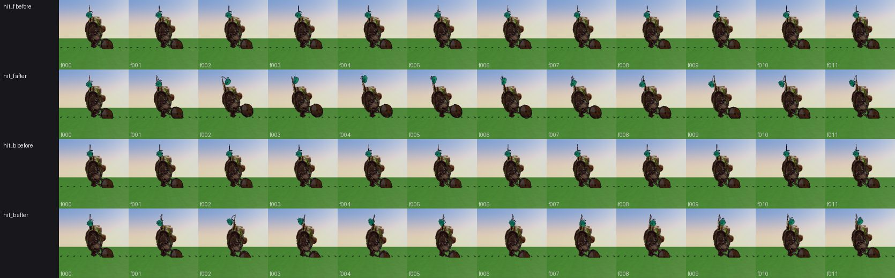
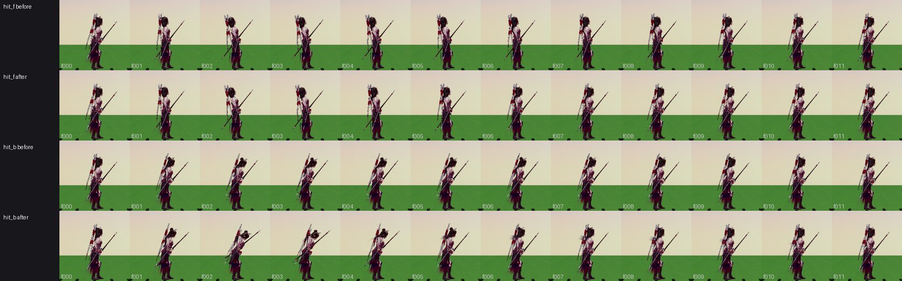

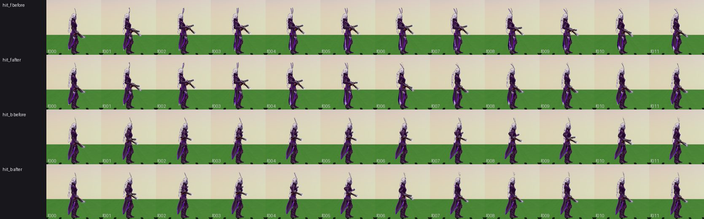
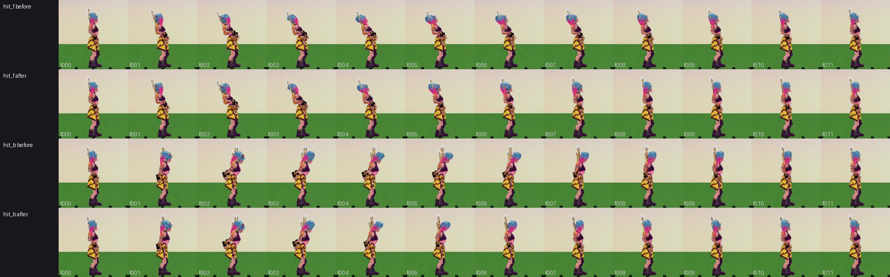

## Match-zoom strips, every Hunter (after the fixes)

Rows: hit_f, hit_b (the game's hand-off, 1/30 s a frame), stun, fall, land (keyed, even across the clip).

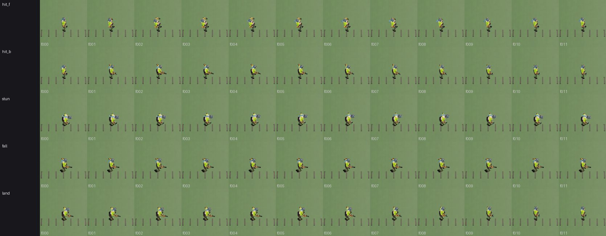
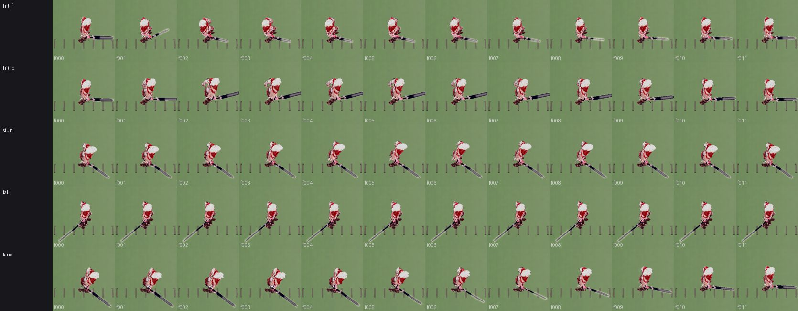
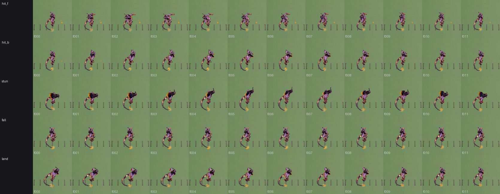
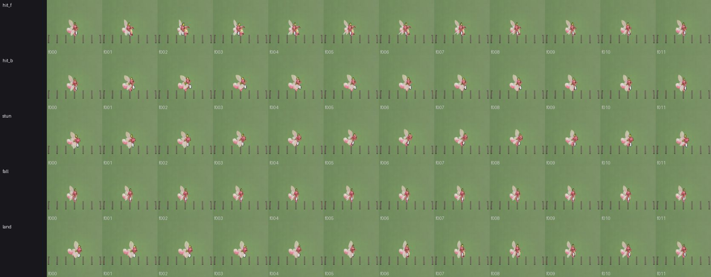
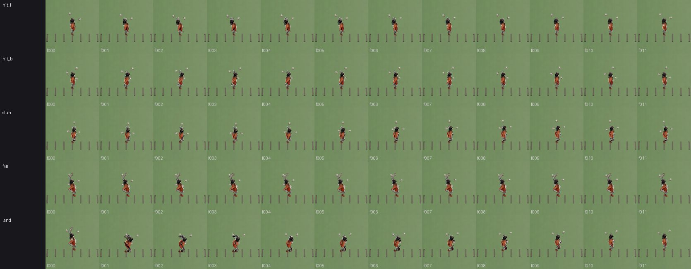
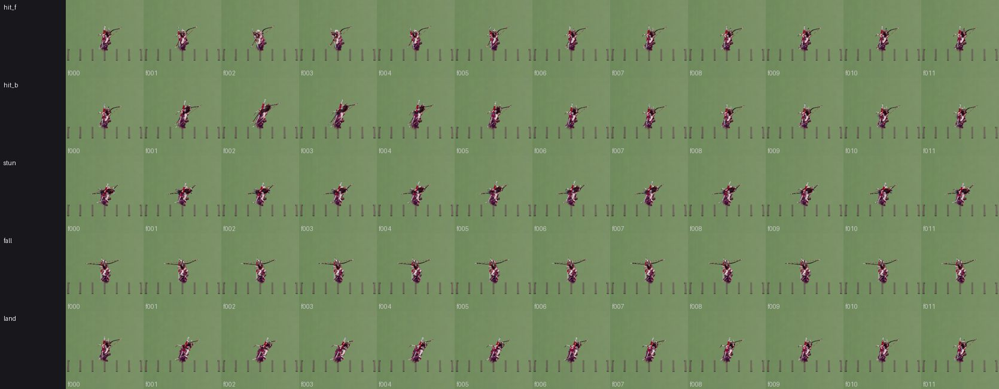
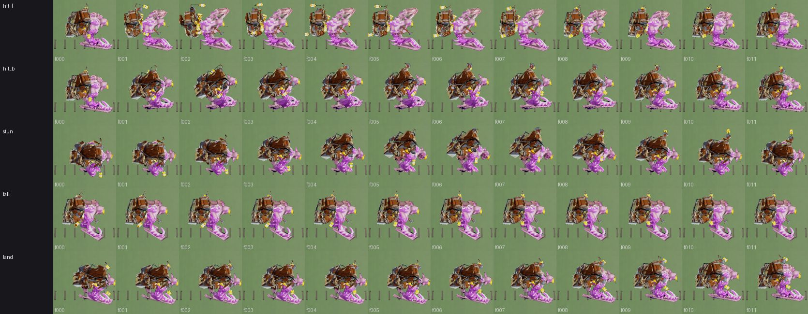
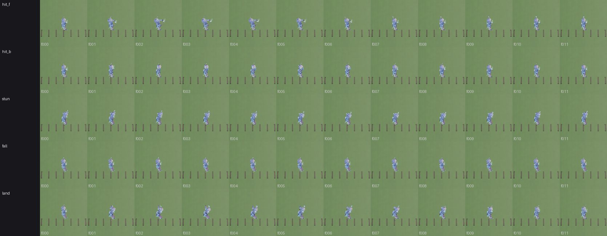
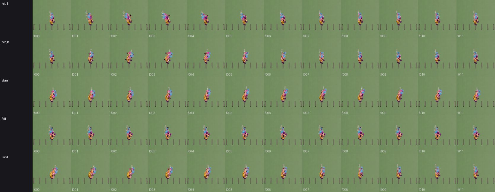
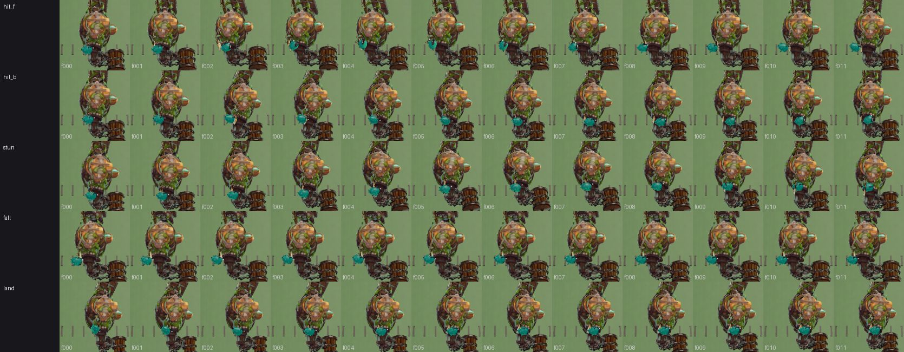
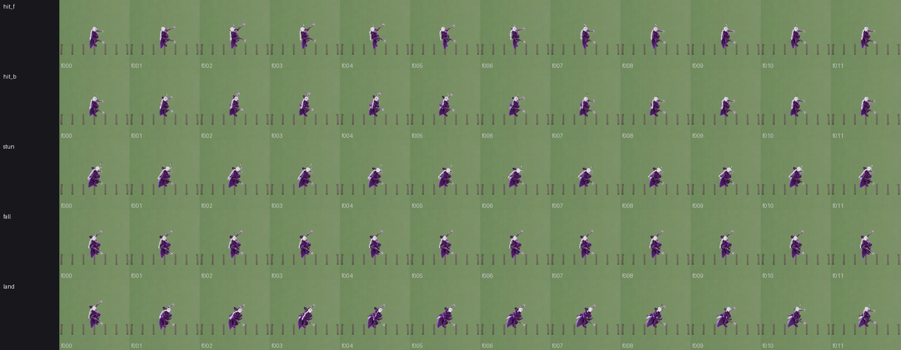
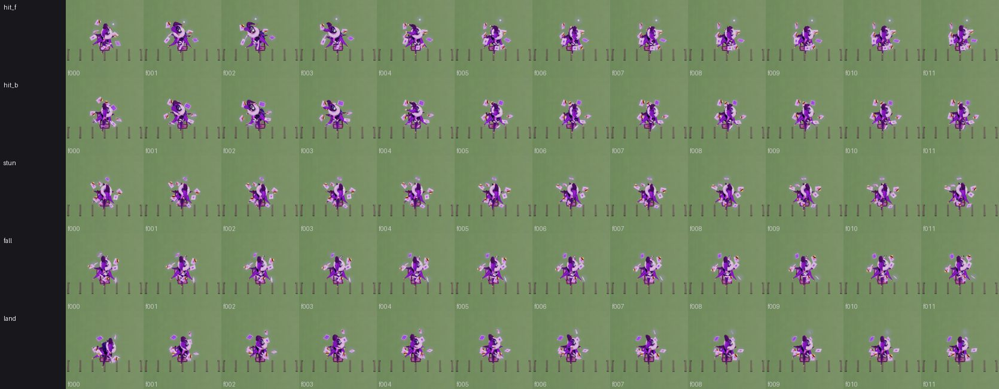
